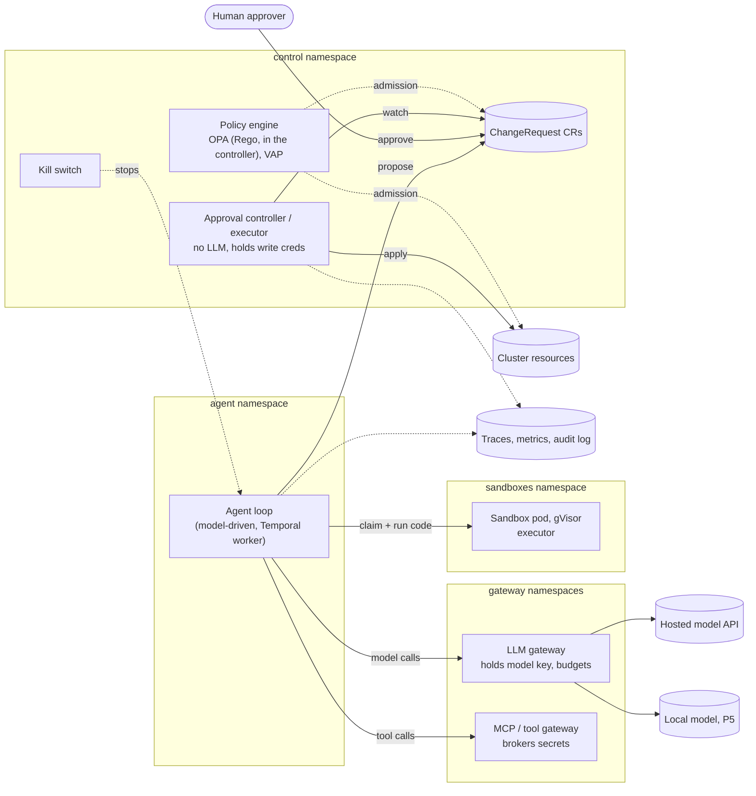

# 02 - Architecture

## Target architecture

The architecture as built: every component below exists, in all five projects.

## Components

| Component | Project | Trust | Holds | Status |
| --- | --- | --- | --- | --- |
| **Sandbox pod** (agent-sandbox `Sandbox` from a `SandboxTemplate`, gVisor) | P1 | Untrusted: runs generated code | Nothing: no SA token, no network, no secrets | Built |
| **Executor** (HTTP service inside the sandbox) | P1 | Not a boundary: same uid as user code | Nothing | Built |
| **Warm pool** (`SandboxWarmPool`) | P1 | Infrastructure | Pre-started sandboxes | Built |
| **Agent loop** | P1-P3 | Semi-trusted: its inputs are attacker-influenced | One workload identity per agent (`runner`, `proposer`); no write credentials; no model key | Built as a scripted Job (P1) and a Temporal worker (P2); model-driven through the LLM gateway, reading MCP tools, since P3 M2-M3 |
| **LLM gateway** | P3 | Trusted | Model API key; token budgets and rate limits | Built (P3 M2); routes the local model to the self-hosted server with that server's key (P5 M1), through the inference gateway since P5 M3 |
| **MCP / tool gateway** | P3 | Trusted | Tool secrets; per-agent authorisation | Built (P3 M3, M5): a static registry in git with per-identity grants, descriptors pinned by hash, and a rule for every tool argument; brokers the tracker's token per call |
| **Policy engine** (OPA embedded in the approval controller; ValidatingAdmissionPolicy) | P1-P3 | Trusted | Rules: allow, deny, escalate | VAPs for claims, approvals and the agents' writes (P1-P2); the semantic action gate in Rego (P3) |
| **ChangeRequest CRD + approval controller / executor** | P2 | Trusted, crown jewel | Namespace-scoped write credentials | Built (M1-M4): CRD, controller, agent proposer role, approval policies, write guard, change budget |
| **Kill switch** | P2 | Trusted | Flag checked by a fail-closed admission policy, plus credential revocation, workflow termination, scale to zero | Built (M4-M5); drilled in the eval suite on every change (P4 M5) |
| **Durable workflow** (Temporal) | P2 | Trusted; no auth of its own, fenced by network policy (GAP-03) | Agent state across long approvals | Built (M5): Temporal dev server with SQLite on a volume; the agent is a worker |
| **Observability** (OTel GenAI traces, Prometheus/Grafana, API audit log) | P4 | Trusted; agent can't write to the store | Traces, metrics, audit | Built (M1): OTel collector (the only way in, attribute allowlist), Jaeger, Prometheus (scrapes the gateways and controller), Grafana. Senders unauthenticated (GAP-06). Built (M2): API audit log over mTLS to a hash-chained sink in namespace `audit` and a node-local log; alerts on tampering, dropped events (GAP-07) and admission changes. Built (M5): only the agent's own metric names pass the collector; oversight health, reopen rate and the latest eval run exported by the controller from the records, with alerts |
| **Eval runner** (Jobs or Argo Workflows; blind LLM judge) | P4 | Trusted, separate identity | Recorded scenarios | Built (M3): a Job as `evals/evaluator`, fresh targets in `eval-sandbox`, a judge on a different model through the LLM gateway, append-only EvalRuns. Reaches Temporal, so GAP-03 covers it. CI runs it on a fresh cluster for every pull request and fails a regression against the baseline in git (M4) |
| **Local inference** (vLLM) | P5 | Infrastructure; a bearer key only the LLM gateway holds | Model weights (hash-verified safetensors) | Built (M1, M2): vLLM in the cluster as a restricted pod in `inference`, on the GPU through the NVIDIA device plugin (CDI); or, as the fallback, in Docker outside the cluster on a network only the node joins (GAP-09: the node can reach that one). Only the LLM gateway may connect, and only `inference` may ask for the GPU. The eval judge can use it. Built (M3): behind the Gateway API Inference Extension, an InferencePool whose endpoint picker (llm-d) chooses the pod, behind an agentgateway Gateway; KEDA scales it from 1 to 2 replicas on two time slices of the GPU when requests queue. Built (M4): the GPU's metrics from NVIDIA's DCGM exporter, a restricted pod on a third slice, into Prometheus and Grafana, with alerts |

## Trust boundaries

| Boundary | Protects | From | Implemented by |
| --- | --- | --- | --- |
| Sandbox | The agent's credentials, guardrails and state | The code it runs (attacker input or mistakes) | Separate pod, gVisor, default-deny network, no SA token, read-only rootfs, non-root, limits, disposable per task |
| Approval gate + executor | The cluster | The agent's proposals, and anyone speaking through the agent | `ChangeRequest` CRD, status-subresource approval, hash binding, admission webhook, executor with no LLM |
| Policy envelope, change budget, rollback | The cluster | Changes that are approved but wrong | Policy engine, budget counter, rollback in every `ChangeRequest` |
| Gateways | Secrets and paid APIs | A compromised or injected agent | Gateways hold secrets; agent authenticates by workload identity |
| Audit trail, kill switch | The ability to notice and recover | Slow drift and incidents nobody caught in time | API audit log to an agent-unwritable store; tested kill switch |

The sandbox never protects the cluster from a bad-but-approved change. That's the gate's job. The gate never protects the agent's credentials from the code it runs. That's the sandbox's job.

## Key flows

**Run code (P1, built).**
1. The agent creates a `SandboxClaim` against the approved warm pool.
2. The claim must pass the admission policy: no added labels, annotations, env or volumes.
3. The agent waits for `Ready`, reads the sandbox's pod IP, and calls `POST /run` on the executor.
4. The agent deletes the claim, and the sandbox is destroyed.
5. A `shutdownTime` on the claim is the backstop if the agent dies.

**Change the cluster (P2, built).**
1. The agent investigates (in sandboxes), then creates a `ChangeRequest` with intent, typed action or diff, blast radius, declared scope and rollback.
2. Policy validates it at admission.
3. A human reviews a deterministic packet computed by the controller (server-side dry run and the diff it implies, blast radius, rule findings, rollback check), with the agent's own account shown last as unverified, and approves through the status subresource. The approval is bound to a hash of the spec and the packet, and expires.
4. The controller re-checks live state against the recorded pre-state, applies with its own scoped credentials, and records pre-state, command and rollback.
5. The agent's durable workflow (Temporal), which has been waiting on the request, resumes when it completes, even if the agent and Temporal restarted in between.

**Call a tool or the model (P3, built).** The agent authenticates to the gateway with its workload identity (a pod-bound token for that gateway's audience). The LLM gateway checks the request as data and the identity's token budget; the MCP gateway checks the identity's grants, the tool's pinned descriptor and every argument. The gateway then injects the secret and calls the model or tool. The agent never sees the secret.

## Environments

| Environment | Used for | Limits |
| --- | --- | --- |
| **kind on WSL2** (default) | All projects; CI-like reproducibility | Stock WSL2 kernel lacks `CONFIG_NFT_QUEUE`, `xt_socket` and TPROXY. That forces an eBPF-only Cilium datapath, under which node-originated traffic is classified as `world`. Kata works through nested KVM with Cloud Hypervisor only (no `vhost_vsock` for QEMU; P1 M7). The GPU is `/dev/dxg`; the device plugin works in CDI mode with four workarounds (P5 M2) |
| **Bare-metal Linux laptop** | Confirming WSL2 workarounds aren't masking issues; bare-metal Kata numbers. Not needed so far: Kata and the GPU both work on WSL2 | Manual setup; not yet used |

Current stack: kind v0.33 (Kubernetes 1.37), containerd 2.3, Cilium 1.20 (kube-proxy replacement, BPF masquerade, no iptables), gVisor `runsc`, agent-sandbox v1.0.4. Setup gotchas are recorded in [P1 findings](../../projects/01-sandboxed-code-exec/README.md#findings-so-far).
