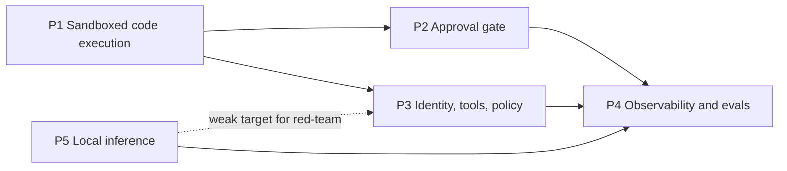

# 04 - Roadmap

## Sequencing

Priority order, given limited hobby hours: **P1 → P2 → P3 → P4**, with **P5 alongside P4**, since a local judge model feeds the evals.

| Phase | Scope | Exit criteria |
| --- | --- | --- |
| 1 | P1 milestones 1-5 | All P1 **Must** requirements done; attack demos and benchmarks published in `results/` |
| 2 | P2 | An agent proposal goes through human approval to apply, with every self-approval and TOCTOU closure tested; kill switch tested |
| 3 | P3 | The agent uses an LLM through the gateway and tools through MCP, holding no secrets; red-team log shows the gate holding when the model complies |
| 4 | P4 + P5 | Traces and cost metrics by default; replay evals gate merges; local model serves as judge/guard |
| 5 | Publication | Capstone architecture write-up and talk |

## Milestones

### P1: sandboxed code execution
1. **Done.** Cluster with gVisor; sandbox hardening verified (`make verify`).
2. **Done.** Executor inside the sandbox; agent-only ingress (`make test-executor`).
3. **Done.** Agent Job claims, uses and releases a sandbox; RBAC, admission and egress fenced (`make test-agent`).
4. **Done.** Attack demos: fork and memory bombs, credential hunt, persistence, TCP egress, DNS exfiltration, ICMP; each shows the stopping layer (`make attack-demos`).
5. **Done.** Benchmarks: cold sandbox vs warm-pool claim; runc vs gVisor overhead (CPU, syscall-heavy, I/O) (`make bench`).
6. **Done.** DNS-scoped egress for tasks that need it (Cilium `toFQDNs`, DNS proxy, SNI pin) (`make test-egress`). Domain fronting remains open (P1-13).
7. **Done.** Kata Containers comparison, on WSL2 through nested KVM with Cloud Hypervisor (`make kata`, `verify-kata`, `attack-demos-kata`, `bench`). Bare-metal numbers remain optional.
8. **Done.** P1 wrap-up: Pod Security enforcement tested (P1-04, `make test-pod-security`); claim released on every error path, including SIGTERM (P1-44), and the `shutdownTime` backstop (P1-21) (`make test-agent`). **Phase 1's exit criteria are met.**

### P2: approval gate
1. **Done.** `ChangeRequest` CRD with immutable spec, status-subresource approval, and the controller (kubebuilder) (`make p2 test-approval`).
2. **Next.** Approval CLI and webhook with authenticated approver identity; hash binding and expiry.
3. Admission webhook rejecting direct writes by the agent's identity.
4. Change budget and kill switch.
5. Durable execution across long approvals; pod-restart demo.
6. Deterministic approval packet and oversight metrics.

### P3: identity, tools and policy
1. Per-agent workload identity (projected SA tokens, then SPIFFE/SPIRE if worthwhile).
2. LLM gateway holding the model key, with token budgets; agent loop switches from scripted to model-driven.
3. MCP servers behind a gateway brokering secrets; pinned descriptors.
4. Kyverno or OPA as the semantic action gate.
5. Prompt-injection red-team.

### P4: observability and evals
1. OTel GenAI traces; Prometheus/Grafana for tokens, cost and escalation rate.
2. API audit logging to an agent-unwritable store.
3. Replay eval suite as Jobs or Argo Workflows; blind judge plus deterministic checks.
4. Regression gate on merges (CI).
5. Oversight and safety metrics; kill-switch test in the suite.

### P5: local inference
1. Model serving outside the cluster (Docker `--gpus all`) as a fallback.
2. In-cluster GPU via device plugin (k3s on WSL2 first, bare metal if needed).
3. Serving stack behind the Gateway API Inference Extension (or KServe/llm-d); autoscaling on queue depth.
4. GPU metrics.

## Deliverables

| Deliverable | When |
| --- | --- |
| Public reference repo with README, threat model and tests | Continuous; public now |
| Blog post per major control (sandbox isolation, approval gate, identity and policy, evals) | As each project completes |
| Capstone: "Defence in depth for autonomous infrastructure agents", with architecture diagram; submitted as a meetup or conference talk | After phase 4 |
| Companion library `agent-guardrails` (framework-agnostic: action guard, change budget, kill switch, approval gate, audit log, independent review) | Separate repo; this repo integrates it once it exists |

## Engineering hygiene backlog

- **CI.** Lint, unit tests, and a kind-based e2e run of the test suites on every PR.
- **Image pinning and signing** (SEC-30). Pin base images by digest, and sign and verify our own images.
- **`gitleaks`** in CI.
- **Repo README threat-model section** linking to [03-security.md](03-security.md).

## Open questions

| Question | Needed by |
| --- | --- |
| ~~Does Cilium's DNS proxy (`toFQDNs`) work with the eBPF-only datapath on the stock WSL2 kernel?~~ Yes, with transparent mode off (and Envoy not using the original source address). | Resolved (P1 M6) |
| Build a custom WSL2 kernel with `xt_socket`/TPROXY/`NFT_QUEUE`, or move networking-sensitive work to bare metal? | Not blocking: each missing-module gap so far has a workaround (P1 README findings 4, 6, 19). Revisit on bare metal (P1 M7) |
| Temporal vs LangGraph `interrupt` for durable execution | P2 M5 |
| Approval channel: CLI only, or a Slack-style webhook with real authentication? | P2 M2 |
| Kyverno vs OPA Gatekeeper vs plain ValidatingAdmissionPolicy for the action gate | P3 M4 |
| SPIFFE/SPIRE vs projected SA tokens for workload identity | P3 M1 |
| Does the NVIDIA device plugin work on WSL2's `/dev/dxg` with k3s? | P5 M2 |
| ~~The kind node sees `/dev/kvm`. Does Kata work there?~~ Yes, with Cloud Hypervisor (QEMU needs `vhost_vsock`, absent from the WSL2 kernel). gVisor's KVM platform is untried. | Resolved (P1 M7) |
| Which hosted model for the agent loop, and its cost budget | P3 M2 |
