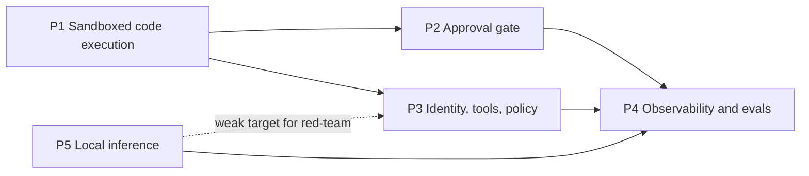

# 04 - Roadmap

## Sequencing

Priority order, given limited hobby hours: **P1 → P2 → P3 → P4**, with **P5 alongside P4**, since a local judge model feeds the evals.

| Phase | Scope | Exit criteria |
| --- | --- | --- |
| 1 | P1 milestones 1-5 | All P1 **Must** requirements done; attack demos and benchmarks published in `results/` |
| 2 | P2 | An agent proposal goes through human approval to apply, with every self-approval and TOCTOU closure tested; kill switch tested |
| 3 | P3 | The agent uses an LLM through the gateway and tools through MCP, holding no secrets; red-team log shows the gate holding when the model complies |
| 4 | P4 + P5 | Traces and cost metrics by default; replay evals gate merges; local model serves as judge/guard |
| 5 | Publication | Capstone architecture write-up and talk |

## Milestones

### P1: sandboxed code execution
1. **Done.** Cluster with gVisor; sandbox hardening verified (`make verify`).
2. **Done.** Executor inside the sandbox; agent-only ingress (`make test-executor`).
3. **Done.** Agent Job claims, uses and releases a sandbox; RBAC, admission and egress fenced (`make test-agent`).
4. **Done.** Attack demos: fork and memory bombs, credential hunt, persistence, TCP egress, DNS exfiltration, ICMP; each shows the stopping layer (`make attack-demos`).
5. **Done.** Benchmarks: cold sandbox vs warm-pool claim; runc vs gVisor overhead (CPU, syscall-heavy, I/O) (`make bench`).
6. **Done.** DNS-scoped egress for tasks that need it (Cilium `toFQDNs`, DNS proxy, SNI pin) (`make test-egress`). Domain fronting remains open (P1-13).
7. **Done.** Kata Containers comparison, on WSL2 through nested KVM with Cloud Hypervisor (`make kata`, `verify-kata`, `attack-demos-kata`, `bench`). Bare-metal numbers remain optional.
8. **Done.** P1 wrap-up: Pod Security enforcement tested (P1-04, `make test-pod-security`); claim released on every error path, including SIGTERM (P1-44), and the `shutdownTime` backstop (P1-21) (`make test-agent`). **Phase 1's exit criteria are met.**

### P2: approval gate
1. **Done.** `ChangeRequest` CRD with immutable spec, status-subresource approval, and the controller (kubebuilder) (`make p2 test-approval`).
2. **Done.** Approval CLI (`approvalctl`) with authenticated approver identity (admission policies, client-certificate approvers); hash binding and expiry (`make test-approval`).
3. **Done.** Admission guard rejecting direct writes by the agent's identity, as a ValidatingAdmissionPolicy (`make test-agent-guard`); limit recorded as GAP-02.
4. **Done.** Change budget (`make test-budget`) and kill switch with its runbook (`make test-kill-switch`, `docs/runbooks/kill-switch.md`).
5. **Done.** Durable execution across long approvals with Temporal; pod-restart demo (`make durable test-durable`).
6. **Done.** Computed review packet (server-side dry run, diff, blast radius, findings, rollback check) and oversight metrics (`make test-review`). **Phase 2's exit criteria are met.**

### P3: identity, tools and policy
1. **Done.** Per-agent workload identity: one service account per agent, audience-bound pod-bound tokens, the gateway's TokenReview authentication (`make p3 test-identity`).
2. **Done.** LLM gateway holding the model key, with per-identity token budgets; the agent loop is model-driven, choosing typed actions through the approval gate (`make p3 test-llm-gateway`).
3. **Done.** MCP tools behind a gateway brokering their secrets; pinned descriptors, no discovery; AI-BOM (`make p3 test-mcp`, `scripts/ai-bom.sh`).
4. **Done.** Semantic action gate: OPA's Rego embedded in the approval controller, deciding on each proposal's computed effect (`make test-policy`).
5. **Done.** Prompt-injection red-team: a fully compliant model against every layer, each attack's stopping layer named; exfiltration through approved tools closed by argument rules and DNS fencing (`make red-team`, `docs/red-team.md`). **Phase 3's exit criteria are met.**

### P4: observability and evals
1. **Done.** OTel GenAI traces, one per task from model call to `ChangeRequest`, content kept out by the collector; Prometheus/Grafana for tokens, cost and escalation rate (`make p4 test-observability`).
2. **Done.** API audit log: the agent's identity and every change to what guards it, over mTLS to a hash-chained sink the agent can't reach or delete; tampering and admission changes alert (`make audit test-audit`).
3. **Done.** Replay eval suite as a Job, as its own identity: scenarios against fresh targets through the real pipeline, deterministic checks plus a blind judge on a different model, append-only verdicts only the evaluator can write (`make evals test-evals`).
4. **Done.** Regression gate on merges: CI builds the stack on kind, replays the scenarios with the mock model and fails a regression against the baseline in git, or an unbaselined change to a scenario, the prompt or the model; a deliberately regressed agent fails it (`make eval-gate test-eval-gate`, `.github/workflows/eval-gate.yml`). Prompt changes aren't scored by the mock (GAP-08).
5. **Done.** Oversight and safety metrics: reopen rate, oversight health per approver with rubber-stamp and override alerts, and the latest eval run beside throughput, all from records the agent can't write or forge; a kill-switch drill in the eval suite, run in CI after the gate (`make eval-kill-switch test-oversight`). P4's Musts are done; P4-15 (seeded known-bad proposals) remains.

### P5: local inference
1. **Done.** Model serving outside the cluster as a fallback: vLLM in Docker on the host's GPU, on a network only the cluster's node joins, reached through the LLM gateway only, with hash-verified safetensors weights; used as an eval judge (`make p5 test-local-model`).
2. **Done.** In-cluster GPU via the device plugin: on kind under WSL2, through CDI (no k3s, no bare metal). vLLM runs as a restricted pod in namespace `inference`; only that namespace may ask for the GPU; the Docker server is the fallback (`make p5 test-gpu`, `scripts/local-model-mode.sh`).
3. **Done.** Serving stack behind the Gateway API Inference Extension: an InferencePool with llm-d's endpoint picker, behind an agentgateway Gateway that only the LLM gateway may reach. KEDA scales vLLM from 1 to 2 replicas on two time slices of the GPU when requests queue (`make p5 test-serving`).
4. **Done.** GPU metrics: NVIDIA's DCGM exporter, which works on this card under WSL2 (no `nvidia-smi` fallback needed), as a restricted pod on a third time slice of the GPU; into Prometheus with alerts, and a Grafana dashboard beside the pool's queue (`make p5 test-gpu-metrics`). P5's milestones are done. **Phase 4's exit criteria are met**: traces and cost metrics by default (P4 M1), replay evals gate merges (P4 M4), and the local model serves as an eval judge (P5 M1).

## Deliverables

| Deliverable | When |
| --- | --- |
| Public reference repo with README, threat model and tests | Continuous; public now |
| Blog post per major control (sandbox isolation, approval gate, identity and policy, evals) | As each project completes |
| Capstone: "Defence in depth for autonomous infrastructure agents", with architecture diagram; submitted as a meetup or conference talk | After phase 4 |
| Companion library `agent-guardrails` (framework-agnostic: action guard, change budget, kill switch, approval gate, audit log, independent review) | Separate repo; this repo integrates it once it exists |

## Engineering hygiene backlog

- **CI.** The eval gate and the kill-switch drill run on every PR (P4 M4, M5). Still to add: lint, the Go and Python unit tests, and the other suites on kind.
- **Image pinning and signing** (SEC-30). Pin base images by digest, and sign and verify our own images.
- **`gitleaks`** in CI.
- **Repo README threat-model section** linking to [03-security.md](03-security.md).

## Open questions

| Question | Needed by |
| --- | --- |
| ~~Does Cilium's DNS proxy (`toFQDNs`) work with the eBPF-only datapath on the stock WSL2 kernel?~~ Yes, with transparent mode off (and Envoy not using the original source address). | Resolved (P1 M6) |
| Build a custom WSL2 kernel with `xt_socket`/TPROXY/`NFT_QUEUE`, or move networking-sensitive work to bare metal? | Not blocking: each missing-module gap so far has a workaround (P1 README findings 4, 6, 19). Revisit on bare metal (P1 M7) |
| ~~Temporal vs LangGraph `interrupt` for durable execution~~ Temporal: replay-based durability with the guarantees the approval wait needs, and independent of the agent framework chosen in P3. | Resolved (P2 M5) |
| ~~Approval channel: CLI only, or a Slack-style webhook?~~ CLI (`approvalctl`) with certificate-authenticated approvers; a chat channel only if it can carry the same identity. | Resolved (P2 M2) |
| ~~Kyverno vs OPA Gatekeeper vs plain ValidatingAdmissionPolicy for the action gate~~ OPA (Rego) embedded in the approval controller: it decides on the computed effect (dry run, blast radius, findings), with no webhook to fail; the VAPs stay as identity and admission guards. | Resolved (P3 M4) |
| ~~SPIFFE/SPIRE vs projected SA tokens for workload identity~~ Projected tokens: audience-bound, pod-bound, revocable, nothing extra to run. SPIRE only if mutual TLS (P3-24) or workloads outside Kubernetes need it. | Resolved (P3 M1) |
| ~~Does the NVIDIA device plugin work on WSL2's `/dev/dxg` with k3s?~~ Yes, and in kind, without k3s: in CDI mode, with the driver copied into the node and four workarounds (P5 README finding 9). | Resolved (P5 M2) |
| ~~The kind node sees `/dev/kvm`. Does Kata work there?~~ Yes, with Cloud Hypervisor (QEMU needs `vhost_vsock`, absent from the WSL2 kernel). gVisor's KVM platform is untried. | Resolved (P1 M7) |
| ~~Which hosted model for the agent loop, and its cost budget~~ `claude-opus-5-5` at effort `medium`, `max_tokens` 8000 per decision; 200 000 tokens per agent identity per hour at the gateway. All are settings (`AGENT_MODEL`, the gateway's `MODELS` and `BUDGET_TOKENS`). | Resolved (P3 M2) |
