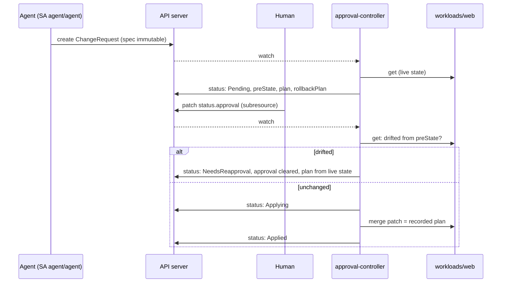

# 02 - Approval gate

## Goal
The agent never changes the cluster directly. It proposes a `ChangeRequest`; a human approves it; a small controller with no LLM applies it with its own narrowly scoped credentials. Nothing the agent can do approves, edits or bypasses that flow.

Requirements and status: [docs/prd/projects/p2-approval-gate.md](../../docs/prd/projects/p2-approval-gate.md).

## Milestones
1. [x] `ChangeRequest` CRD with immutable spec, status-subresource approval, and the controller (kubebuilder); `make p2 test-approval` (37 checks)
2. [ ] Approval CLI and webhook with authenticated approver identity; hash binding and expiry
3. [ ] Admission webhook rejecting direct writes by the agent's identity
4. [ ] Change budget and kill switch
5. [ ] Durable execution across long approvals
6. [ ] Deterministic approval packet and oversight metrics

## How it works



- **Spec** (`api/v1alpha1/changerequest_types.go`): intent, a typed action (`ScaleDeployment` with replicas, or `RestartDeployment`), blast radius, declared scope (namespaces, kinds) and a rollback procedure. A CEL rule (`self == oldSelf`) makes the spec immutable, even for cluster admins, so an approval always refers to what was reviewed.
- **Typed actions only.** The agent chooses an action and its parameters; the controller computes the exact merge patch. There is no free-form command path.
- **Recorded before it runs.** On proposal, the controller records the target's pre-state (generation, replicas, restart annotation), the exact patch, and the exact rollback patch. The restart timestamp is fixed at proposal time, so the approved plan is byte-for-byte what runs, and re-running it after a crash is idempotent.
- **Approval** is written by a human to `status.approval` through the status subresource. The agent's role (`manifests/40-agent-rbac.yaml`) can create, get, list and watch ChangeRequests in `approvals`: no update, no delete, nothing on `changerequests/status`, and no write access to `workloads`.
- **Time of check vs time of use.** Before applying, the controller compares the target's live state with the recorded pre-state. If anything changed (any spec edit bumps the generation), it clears the approval, re-proposes from live state, and waits in `NeedsReapproval`.
- **Scope.** An action outside its declared scope is rejected, and a later approval doesn't revive it.
- **The controller's reach** (`config/rbac/role.yaml`, generated from markers): read ChangeRequests and write their status; `get`/`patch` Deployments in `workloads` only. No create/delete, no pods, no other namespaces. Default-deny network policy with egress to the API server only.

## Not yet (next milestones)
- **The approver is whatever the human writes.** Anyone with `update` on `changerequests/status` can approve and name any approver. Milestone 2 records the approver from the authenticated request identity, binds the approval to a hash of the spec and gives it an expiry.
- Nothing stops the agent's identity from writing to resources a webhook should protect beyond RBAC (milestone 3), and there's no change budget or kill switch yet (milestone 4).

## Layout
Kubebuilder layout, trimmed to what's used: `api/` (types), `internal/controller/` (reconciler and its pure decision functions, unit-tested in `logic_test.go`), `config/crd/bases/` and `config/rbac/role.yaml` (generated by `make manifests`), `manifests/` (hand-written deployment: namespaces, bindings, controller, agent role, network policy, demo workload). Kustomize overlays aren't used: their namespace rewrite would move the controller's `workloads` Role into its own namespace.

The controller binary is built on the host (`make build`; Go from `scripts/setup-go.sh`) and copied into a distroless image, rather than compiled inside a large Go builder image.

## Run
```bash
./scripts/setup-go.sh      # once, no sudo: Go into ~/.local/go
make p2                    # build, load into kind, apply CRD, RBAC, controller
make test-approval         # 37 checks
```
