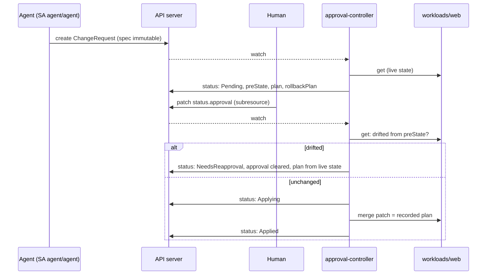

# 02 - Approval gate

## Goal
The agent never changes the cluster directly. It proposes a `ChangeRequest`; a human approves it; a small controller with no LLM applies it with its own narrowly scoped credentials. Nothing the agent can do approves, edits or bypasses that flow.

Requirements and status: [docs/prd/projects/p2-approval-gate.md](../../docs/prd/projects/p2-approval-gate.md).

## Milestones
1. [x] `ChangeRequest` CRD with immutable spec, status-subresource approval, and the controller (kubebuilder)
2. [x] Approval CLI (`approvalctl`) with authenticated approver identity; hash binding and expiry. `make p2 test-approval`: 58 checks
3. [ ] Admission webhook rejecting direct writes by the agent's identity
4. [ ] Change budget and kill switch
5. [ ] Durable execution across long approvals
6. [ ] Deterministic approval packet and oversight metrics

## How it works



- **Spec** (`api/v1alpha1/changerequest_types.go`): intent, a typed action (`ScaleDeployment` with replicas, or `RestartDeployment`), blast radius, declared scope (namespaces, kinds) and a rollback procedure. A CEL rule (`self == oldSelf`) makes the spec immutable, even for cluster admins, so an approval always refers to what was reviewed.
- **Typed actions only.** The agent chooses an action and its parameters; the controller computes the exact merge patch. There is no free-form command path.
- **Recorded before it runs.** On proposal, the controller records the target's pre-state (generation, replicas, restart annotation), the exact patch, and the exact rollback patch. The restart timestamp is fixed at proposal time, so the approved plan is byte-for-byte what runs, and re-running it after a crash is idempotent.
- **Approval** is written by a human to `status.approval` through the status subresource, normally with `approvalctl`. The agent's role (`manifests/40-agent-rbac.yaml`) can create, get, list and watch ChangeRequests in `approvals`: no update, no delete, nothing on `changerequests/status`, and no write access to `workloads`.
- **Who approves** (`manifests/70-approval-policies.yaml`). RBAC can only say "may update status", so two admission policies cover the rest, with no webhook to run:
  - a `MutatingAdmissionPolicy` overwrites `approval.approver` with the authenticated username whenever an approval is set or changed: the object can't name someone else;
  - a `ValidatingAdmissionPolicy` requires the writer to be in `safe-ops:approvers` and not a service account (even one given that group), lets only the controller withdraw an approval, and lets only the controller change the fields it owns. Without that last rule, an approver could rewrite `status.plan`, which is what gets applied.
- **Approvers authenticate with client certificates** (`scripts/new-approver.sh NAME`): CN is the username, O is `safe-ops:approvers`. The key is generated locally; the cluster's CSR API signs it; the result is a standalone kubeconfig. A cluster admin who isn't in the group can't approve, short of editing the policies.
- **Hash binding.** `status.reviewHash` is a sha256 over the request's UID, spec, pre-state, plan and rollback plan: everything the approver sees. An approval must carry it; one for any other hash is discarded with an explanation. Re-planning after drift changes the hash, so earlier approvals can't be replayed.
- **Expiry.** `status.expiresAt` = proposal time + `spec.approvalWindowSeconds` (default 1 h, max 1 day), judged by the controller's clock. Unanswered requests expire on time (the controller requeues for it); late approvals apply nothing. The approval's own `time` is informational: admission policy CEL has no clock, so a client-written time can't be trusted.
- **`approvalctl`** (`cmd/approvalctl`): `list`, `show`, `approve`, `reject`. It shows the packet in three parts (the agent's free-text account, the typed action, and what the controller computed and will run), asks for confirmation, and writes the decision with the review hash, conditional on the `resourceVersion` it displayed.
- **Time of check vs time of use.** Before applying, the controller compares the target's live state with the recorded pre-state. If anything changed (any spec edit bumps the generation), it clears the approval, re-proposes from live state, and waits in `NeedsReapproval`.
- **Scope.** An action outside its declared scope is rejected, and a later approval doesn't revive it.
- **The controller's reach** (`config/rbac/role.yaml`, generated from markers): read ChangeRequests and write their status; `get`/`patch` Deployments in `workloads` only. No create/delete, no pods, no other namespaces. Default-deny network policy with egress to the API server only.

## Findings
1. **Kustomize's `namespace:` would have broken the controller's scoping.** It rewrites every namespaced object, including the controller's `workloads` Role, which would land in the controller's own namespace. Deployed with plain manifests instead.
2. **RBAC can't separate fields within `status`.** Anyone allowed to approve could also rewrite `status.plan` (what the controller applies) or `status.phase`. A ValidatingAdmissionPolicy now lets only the controller change its own fields.
3. **A full status `Update` from the controller looked like tampering.** The controller re-serialized the whole status from its Go type, and an approval that didn't round-trip byte for byte (`"comment": ""`, dropped by `omitempty`) appeared changed. The policy correctly refused, and every CLI approval stalled in Pending. The controller now writes merge patches against the state it last read, with `resourceVersion` as a precondition, so it only sends what it changed. A regression check approves with an empty comment.
4. **Admission policies have no clock.** CEL can't compare a client-written timestamp with "now", so expiry is judged by the controller against the `expiresAt` it set itself.
5. **Retried conflicts are logged as errors.** `Reconciler error ... Operation cannot be fulfilled` lines are optimistic-lock conflicts, e.g. a human writing as the controller does; the reconcile reruns with fresh state. Expected, not a fault.

## Not yet (next milestones)
- Nothing stops the agent's identity from writing to resources a webhook should protect beyond RBAC (milestone 3), and there's no change budget or kill switch yet (milestone 4).

## Layout
Kubebuilder layout, trimmed to what's used: `api/` (types), `internal/controller/` (reconciler and its pure decision functions, unit-tested in `logic_test.go`), `config/crd/bases/` and `config/rbac/role.yaml` (generated by `make manifests`), `manifests/` (hand-written deployment: namespaces, bindings, controller, agent role, network policy, demo workload). Kustomize overlays aren't used: their namespace rewrite would move the controller's `workloads` Role into its own namespace.

The controller binary is built on the host (`make build`; Go from `scripts/setup-go.sh`) and copied into a distroless image, rather than compiled inside a large Go builder image.

## Run
```bash
./scripts/setup-go.sh                   # once, no sudo: Go into ~/.local/go
make p2                                 # build controller and CLI, apply CRD, RBAC, policies, controller
make test-approval                      # 58 checks
./scripts/new-approver.sh alice         # writes ~/.kube/safe-ops-approver-alice.kubeconfig
export KUBECONFIG=~/.kube/safe-ops-approver-alice.kubeconfig
projects/02-approval-gate/bin/approvalctl list
projects/02-approval-gate/bin/approvalctl approve <name>
```
