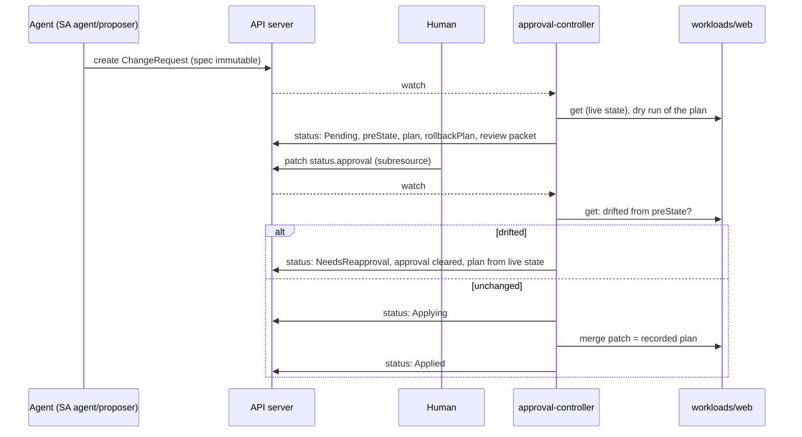

# 02 - Approval gate

## Goal
The agent never changes the cluster directly. It proposes a `ChangeRequest`; a human approves it; a small controller with no LLM applies it with its own narrowly scoped credentials. Nothing the agent can do approves, edits or bypasses that flow.

Requirements and status: [docs/prd/projects/p2-approval-gate.md](../../docs/prd/projects/p2-approval-gate.md).

## Milestones
1. [x] `ChangeRequest` CRD with immutable spec, status-subresource approval, and the controller (kubebuilder)
2. [x] Approval CLI (`approvalctl`) with authenticated approver identity; hash binding and expiry. `make p2 test-approval`: 58 checks
3. [x] Admission guard rejecting direct writes by the agent's identity (a ValidatingAdmissionPolicy). `make test-agent-guard`: 50 checks (33 at the time; per-identity checks added in P3)
4. [x] Change budget and kill switch, with a runbook. `make test-budget`: 32 checks; `make test-kill-switch`: 43 checks
5. [x] Durable execution across long approvals, with Temporal; pod-restart demo. `make durable test-durable`: 40 checks
6. [x] Computed review packet and oversight metrics. `make test-review`: 40 checks

## How it works



- **Spec** (`api/v1alpha1/changerequest_types.go`): intent, a typed action (`ScaleDeployment` with replicas, or `RestartDeployment`), blast radius, declared scope (namespaces, kinds) and a rollback procedure. A CEL rule (`self == oldSelf`) makes the spec immutable, even for cluster admins, so an approval always refers to what was reviewed.
- **Typed actions only.** The agent chooses an action and its parameters; the controller computes the exact merge patch. There is no free-form command path.
- **Recorded before it runs.** On proposal, the controller records the target's pre-state (generation, replicas, restart annotation), the exact patch, and the exact rollback patch. The restart timestamp is fixed at proposal time, so the approved plan is byte-for-byte what runs, and re-running it after a crash is idempotent.
- **Approval** is written by a human to `status.approval` through the status subresource, normally with `approvalctl`. The agent's role (`manifests/40-agent-rbac.yaml`) can create, get, list and watch ChangeRequests in `approvals`: no update, no delete, nothing on `changerequests/status`, and no write access to `workloads`.
- **Who approves** (`manifests/70-approval-policies.yaml`). RBAC can only say "may update status", so two admission policies cover the rest, with no webhook to run:
  - a `MutatingAdmissionPolicy` overwrites `approval.approver` with the authenticated username whenever an approval is set or changed: the object can't name someone else;
  - a `ValidatingAdmissionPolicy` requires the writer to be in `safe-ops:approvers` and not a service account (even one given that group), lets only the controller withdraw an approval, and lets only the controller change the fields it owns. Without that last rule, an approver could rewrite `status.plan`, which is what gets applied.
- **Approvers authenticate with client certificates** (`scripts/new-approver.sh NAME`): CN is the username, O is `safe-ops:approvers`. The key is generated locally; the cluster's CSR API signs it; the result is a standalone kubeconfig. A cluster admin who isn't in the group can't approve, short of editing the policies.
- **Hash binding.** `status.reviewHash` is a sha256 over the request's UID, spec, pre-state, plan and rollback plan: everything the approver sees. An approval must carry it; one for any other hash is discarded with an explanation. Re-planning after drift changes the hash, so earlier approvals can't be replayed.
- **Expiry.** `status.expiresAt` = proposal time + `spec.approvalWindowSeconds` (default 1 h, max 1 day), judged by the controller's clock. Unanswered requests expire on time (the controller requeues for it); late approvals apply nothing. The approval's own `time` is informational: admission policy CEL has no clock, so a client-written time can't be trusted.
- **`approvalctl`** (`cmd/approvalctl`): `list`, `show`, `approve`, `reject`, `budget`, `stats`. It shows the packet with what the controller computed first and the agent's free-text account last, asks for confirmation, and writes the decision with the review hash, conditional on the `resourceVersion` it displayed.
- **Review packet** (`internal/controller/review.go`, P2-40). At every proposal the controller builds `status.review` from the cluster, with no model involved:
  - a **server-side dry run** of the exact plan, admission included, and the **field diff** between the live object and the dry run's result (so defaulting and mutating admission show up);
  - the **blast radius** computed from the live object: pods added, removed or replaced, how many a rollout may take down at once, and the PodDisruptionBudgets that select the pods;
  - **findings** from fixed rules: `DryRunRefused`, `ScaleToZero` and `BelowDisruptionBudget` (Critical); `LargeScaleUp`, `LargeScaleDown`, `RolloutTakesAllPods`, `TargetDegraded` and `RolloutInProgress` (Warning); `NoChange` (Info);
  - a **rollback check**: the rollback patch applied to the dry run's result must restore every reviewed field of the pre-state.
  The packet is covered by the review hash, so an approval binds to it, and only the controller may write it. The same state always gives the same packet. `approvalctl show` adds the change budget's remaining capacity, and labels the agent's blast radius and rollback as claimed. Approving a request with a Critical finding needs `--accept-critical`. The change budget pays only for requests the semantic action gate allows (P2-44; since P3 milestone 4 the gate is `policy/gate.rego`, which escalates any Warning or Critical finding and denies some changes outright: see `../03-tool-access/README.md`).
- **Oversight metrics** (`internal/oversight`, P2-42). Recomputed from the ChangeRequests on every call, never counted in memory: per approver, approvals, rejections, approval rate, time from proposal to decision (median, p90), and approvals of requests with Warning or Critical findings (a rubber-stamping signal); overall, outcomes by what settled them (humans, change budget, controller, expiry, kill switch) and re-proposals after drift. `approvalctl stats` prints them. The controller exports them as Prometheus metrics (`safeops_approver_decisions`, `safeops_approver_approvals_flagged`, `safeops_changerequest_time_to_decision_seconds`, `safeops_changerequest_outcomes`, ...) on :8443 over HTTPS, each scrape authenticated and authorized by the API server (P4: only Prometheus's identity may read them, and only Prometheus can connect). The controller records `proposedAt`, `decidedAt` and the proposal count for this. P4 milestone 5 added each approver's median and p90 time to decide (`safeops_approver_decision_seconds`), the reopen rate (`safeops_changerequests_reopened`: an applied change followed within an hour by another proposal for the same target) and the latest eval run (`safeops_eval_*`, read from P4's EvalRuns), with alerts on them in P4's Prometheus.
- **Seeded test proposals** (`internal/controller/seeded.go`, P2-43 / P4-15). Proposals the seeder slips in among the agent's, listed in a seed key (ConfigMap `approval-system/seeded-proposals`) that approvers and the agent can't read. The controller reviews them like any other and never applies one: an approval, or a change budget that would pay, ends it `Withheld`. Once final it records `status.seeded`, how the automated review and the human did; the oversight metrics turn that into catch rates. Details in [P4's README](../04-observability/README.md#seeded-known-bad-proposals-p4-15).
- **Time of check vs time of use.** Before applying, the controller compares the target's live state with the recorded pre-state. If anything changed (any spec edit bumps the generation), it clears the approval, re-proposes from live state, and waits in `NeedsReapproval`.
- **Scope.** An action outside its declared scope is rejected, and a later approval doesn't revive it.
- **Backstop on the agent's writes** (`manifests/80-agent-write-guard.yaml`). A ValidatingAdmissionPolicy matched only to the agent's identity refuses every create, update, delete or connect (exec included) outside an allowlist: create/delete SandboxClaims in `sandboxes`, create ChangeRequests in `approvals`, and self-review calls. It fails closed. If the agent's RBAC is ever widened by mistake, it still can't change the cluster except by proposing. A policy rather than a webhook: same admission point, but evaluated in the API server, with no TLS or extra service to fail. It can't protect admission configuration itself ([GAP-02](../../docs/known-gaps.md#gap-02-admission-guards-cant-protect-their-own-configuration)).
- **Change budget** (`ChangeBudget` named `default` in the request's namespace; example in `examples/change-budget.yaml`). Up to `maxChanges` changes per rolling `windowSeconds` apply without a human, if code says they're eligible: an allowed action type, an allowed target namespace, and for scaling a replica count within `minReplicas`-`maxReplicas` (so never to zero by default). The controller consults it once, right after recording the plan: it records the grant in the budget's status (with `resourceVersion` as a precondition, keyed by the request's UID so a retry doesn't pay twice), then sets `status.budgetGrant` bound to the review hash and applies through the same drift check as a human approval. Anything ineligible, or past the budget, waits for an approver and keeps waiting even if budget frees up later; drift after a grant needs a human too. Without a budget, every change waits (the default; `make p2` installs none). Operators write the budget; approvers can read it (`approvalctl budget`); the agent can do neither, and only the controller may write `budgetGrant`.
- **Kill switch** (`manifests/90-kill-switch.yaml`, `scripts/kill-switch.sh`, runbook [docs/runbooks/kill-switch.md](../../docs/runbooks/kill-switch.md)). The flag is ConfigMap `approval-system/agent-kill-switch`; the agent runs only while `mode` is exactly `run`. One command (`kill-switch.sh stop --reason ...`) sets it to `stop`, then suspends and deletes the agent's workloads, recreates its ServiceAccount (revoking every token for it, copies outside the cluster included), and releases its sandboxes. From the flag on:
  - a ValidatingAdmissionPolicy, with the ConfigMap as its parameter, refuses the agent's new claims and proposals, and any new pod or token in the `agent` namespace, from anyone. A Job that's un-suspended can't bring the agent back;
  - the controller cancels every request that hasn't started applying (`Cancelled`), whoever approved it, and applies nothing more. It watches the flag (caching only that one ConfigMap) and treats missing or unreadable as stopped.
  `make p2` creates the flag only if it's missing, so re-deploying never resumes a stopped agent.
- **Durable execution** (`durable/`). The agent runs as a Temporal worker (`durable/agent/`, Deployment `agent-worker`, as the agent's service account), and each task it's given is a `ChangeWorkflow`:
  1. `propose` creates the ChangeRequest, named after the task and annotated with the workflow ID. If it already exists from an earlier attempt of the same workflow (a crash after creating it), it's adopted; if anyone else's, the workflow fails rather than act on it.
  2. `await_decision` polls the ChangeRequest for a few minutes, heartbeating every poll, and reports back. The workflow repeats it until the request is final (Applied, Rejected, Failed, Expired, Cancelled), and returns the outcome and who decided.
  - The workflow code does no I/O, so Temporal replays it on any worker. A worker that dies mid-poll misses a heartbeat, and the poll is rescheduled within 20 s. With no worker at all, the workflow simply waits in Temporal, for as long as the ChangeRequest's own expiry allows.
  - A long wait doesn't grow without bound: the workflow continues as new when Temporal suggests it (or after `polls_per_run` polls), carrying its progress, so the proposal is never repeated.
  - Temporal is the single-binary dev server with SQLite on a volume (`durable/manifests/10-temporal.yaml`). Only the worker can reach its frontend, which has no authentication ([GAP-03](../../docs/known-gaps.md#gap-03-temporals-frontend-has-no-authentication)). The worker's egress is the API server, one DNS name and Temporal; not the sandboxes.
  - The kill switch terminates every running workflow, then scales the worker to zero with the rest of the agent.
- **The controller's reach** (`config/rbac/role.yaml`, generated from markers): read ChangeRequests and ChangeBudgets and write their status; `get`/`patch` Deployments in `workloads` only; read ConfigMaps in its own namespace (the flag). No create/delete, no pods, no other namespaces. Default-deny network policy with egress to the API server only.

## Findings
1. **Kustomize's `namespace:` would have broken the controller's scoping.** It rewrites every namespaced object, including the controller's `workloads` Role, which would land in the controller's own namespace. Deployed with plain manifests instead.
2. **RBAC can't separate fields within `status`.** Anyone allowed to approve could also rewrite `status.plan` (what the controller applies) or `status.phase`. A ValidatingAdmissionPolicy now lets only the controller change its own fields.
3. **A full status `Update` from the controller looked like tampering.** The controller re-serialized the whole status from its Go type, and an approval that didn't round-trip byte for byte (`"comment": ""`, dropped by `omitempty`) appeared changed. The policy correctly refused, and every CLI approval stalled in Pending. The controller now writes merge patches against the state it last read, with `resourceVersion` as a precondition, so it only sends what it changed. A regression check approves with an empty comment.
4. **Admission policies have no clock.** CEL can't compare a client-written timestamp with "now", so expiry is judged by the controller against the `expiresAt` it set itself.
5. **Retried conflicts are logged as errors.** `Reconciler error ... Operation cannot be fulfilled` lines are optimistic-lock conflicts, e.g. a human writing as the controller does; the reconcile reruns with fresh state. Expected, not a fault.
6. **A fail-closed policy with one unguarded field read blocked everything.** In an admission request, empty fields such as `subResource` and `namespace` are absent, not `""`. Reading `request.subResource` directly raised "no such key", and `failurePolicy: Fail` turned that into denying the agent's legitimate claims and proposals. It would have taken the agent down on first use. Read optional fields with `request.?subResource.orValue("")`, and test the allowed paths, not just the denials.
7. **Admission can't guard admission configuration** ([GAP-02](../../docs/known-gaps.md#gap-02-admission-guards-cant-protect-their-own-configuration)). With widened RBAC, the agent could delete the guard and the approval policies: Kubernetes never applies admission policies or webhooks to their own configuration objects. Neither can it see impersonation, or escalate/bind on RBAC. The suite asserts the agent holds none of these.
8. **The suite's own helper talked to the wrong cluster.** A `sh -c` child shell didn't inherit `scripts/lib.sh`'s context pin and ran against whatever context was current (another project's cluster). That's P1 finding 17 again, this time in the test harness. The suite pipes into the pinned function instead.

9. **A missing admission parameter denies everything the binding matches, whoever asks.** With `parameterNotFoundAction: Deny`, the API server refuses before evaluating `matchConditions` (probed: a policy whose match condition was always false still denied every request in scope). A kill switch matched like `agent-write-guard` (all resources, narrowed to the agent by a match condition) would turn a deleted ConfigMap into a cluster-wide write outage. Its bindings match only the agent's surfaces: claims and proposals in `sandboxes` and `approvals`, pods and tokens in `agent`. A missing flag freezes exactly those, for everyone, and nothing else.
10. **Re-deploying could have un-stopped the agent.** With the flag in `manifests/`, `make p2` would re-apply `mode: run` over a `stop`. The flag isn't a manifest: `make p2` creates it only if missing.
11. **Admission can't stop reads.** A copy of the agent's token kept listing proposals with the flag at `stop`. Recreating the ServiceAccount ended it: bound tokens carry the account's UID, and the API server refuses tokens for a UID that no longer exists. RoleBindings name the account, so they carry over to the new one; the copy stays dead after resuming.
12. **A stopping agent can still clean up.** The switch refuses claim creation but not deletion, so the agent's SIGTERM handler released its sandbox before the script's own release step ran (it found 0 claims). Refusing everything would have left claims for the script, or the `shutdownTime` backstop, to collect.
13. **Which policy reports a denial isn't stable.** After the policies were re-applied, a status write by the agent's identity was refused by `agent-write-guard` rather than the approval policy, failing a test that expected the latter's message. Both refusals were correct. The check now uses a different service account, so it tests the approval policy alone.
14. **The budget is consulted once.** A request that wasn't eligible or found the budget spent keeps waiting for a human, even after the window frees budget, so nothing changes under an approver who's reviewing it. The controller runs one worker, so concurrent proposals are paid for one at a time; the precondition on the budget's `resourceVersion` is what keeps more workers or replicas from overspending.

15. **Kubelet probes arrive as `world` under this Cilium setup** (P1 README finding 6 again). Temporal's `tcpSocket` readiness probe timed out: Cilium's drop log showed the SYNs from the host's address (`10.244.0.1`) classed as `world`, and the namespace's default-deny ingress dropped them. The controller's manifest already noted this for HTTP probes; it applies to every network probe here. Temporal now has an exec probe.
16. **Blocked DNS stalled a server that needs no DNS.** Temporal talks to itself on localhost, but its gRPC clients still look up TXT and SRV records for `localhost` through every search domain. With egress denied, the queries were dropped, each internal call waited out the resolver timeout, and the server never became healthy. Pointing its resolver at `127.0.0.1` (nothing listens) with no search domains makes them fail at once. Cilium's drop log showed the queries; a temporary DNS-proxy policy with `matchPattern: "*"` named them.
17. **A second, optional workflow parameter turned the first into a dict.** The Temporal Python SDK ignores a workflow's parameter types when the number of inputs differs from the number of parameters, so `run(task, progress=None)` started with one input received `task` as a plain dict. The workflow takes one dataclass, and the continue-as-new progress is a field in it.
18. **The worker ignored SIGTERM while connecting.** Its handler was installed after `Client.connect`, which retries while Temporal is down; as PID 1 it ignored SIGTERM and hung in `Terminating`. The P1 finding again, in a new place. The handler now goes first, and stopping cancels the connect.
19. **The kill switch stopped halfway when a workflow raced it.** One finished between being listed and being terminated; the error aborted the script under `set -e`, so the worker was never scaled down. The workflow step now reports failures and never aborts, and the test caught it because it checks every layer after a stop, not just the step it added.

20. **The review rules changed what the budget pays for, as intended, and broke the budget suite.** A restart proposed right after an autonomous scale-up found the new pod not yet ready (`TargetDegraded`), so the budget declined it; a 3 to 1 scale-down is now `LargeScaleDown`. Both are the rules working. The suite now waits for the target to settle before each autonomous proposal, and checks explicitly that a flagged change isn't paid for.
21. **An absent map and an empty one diff as different.** A rollback that removes the only restart annotation leaves `annotations: {}`, while the pre-state had no `annotations` at all; the first rollback check reported that as a change. The diff now descends into a map when the other side has none. Numbers needed the same care: the object converter yields `int64`, JSON `float64`, so the rollback check compares JSON with JSON.
22. **Approving a stale proposal in a test hit drift, correctly.** A request reviewed before another change scaled the target re-proposed on approval instead of applying. The test now decides on a fresh proposal; the behaviour is P2-04 doing its job.
23. **Backgrounding a shell function loses the process.** `kubectl port-forward ... &` through `scripts/lib.sh`'s context-pinning `kubectl` function backgrounds a subshell; `$!` is the subshell, and killing it left the port-forward running after the test. The test backgrounds the `kubectl` binary itself (`command kubectl --context ...`).
24. **Two check counts were reported wrong.** The kill-switch suite had 42 checks, not 46 (milestone 4), and the budget suite 31, then 32, not 33 and 34 (milestones 4 and 6). They were added up by hand instead of counted. Counts in this README now come from the PASS lines of a run.

## Not yet
- Rollback is a new proposal of the inverse action; there's no one-step "roll back request X" action.
- Metrics aren't scraped yet (P4).

## Layout
Kubebuilder layout, trimmed to what's used: `api/` (types), `internal/controller/` (reconciler and its pure decision functions: `bounds.go` for the budget and kill switch, `review.go` for the packet; unit-tested), `internal/oversight/` (metrics computed from the record; unit-tested), `config/crd/bases/` and `config/rbac/role.yaml` (generated by `make manifests`), `manifests/` (hand-written deployment: namespaces, bindings, controller, agent role, network policy, demo workload). Kustomize overlays aren't used: their namespace rewrite would move the controller's `workloads` Role into its own namespace. `durable/` holds milestone 5: the agent worker (`agent/`: workflow, activities, worker; Python, `temporalio`) and its manifests (Temporal, network policy, worker Deployment), deployed by `make durable`, separate from `make p2`.

The controller binary is built on the host (`make build`; Go from `scripts/setup-go.sh`) and copied into a distroless image, rather than compiled inside a large Go builder image.

## Run
```bash
./scripts/setup-go.sh                   # once, no sudo: Go into ~/.local/go
make p2                                 # build controller and CLI, apply CRD, RBAC, policies, controller
make test-approval                      # 58 checks
make test-agent-guard                   # 50 checks; temporarily widens the agent's RBAC
make test-budget                        # 32 checks; creates and removes a ChangeBudget
make test-kill-switch                   # 43 checks; stops a running agent, resumes, leaves mode=run
make durable                            # Temporal and the agent worker
make test-durable                       # 40 checks; restarts both mid-approval
make test-review                        # 40 checks; review packet, overrides, oversight metrics, rollback
projects/02-approval-gate/bin/approvalctl stats
./scripts/kill-switch.sh status         # stop --reason TEXT | resume --reason TEXT
./scripts/new-approver.sh alice         # writes ~/.kube/safe-ops-approver-alice.kubeconfig
export KUBECONFIG=~/.kube/safe-ops-approver-alice.kubeconfig
projects/02-approval-gate/bin/approvalctl list
projects/02-approval-gate/bin/approvalctl approve <name>
```
