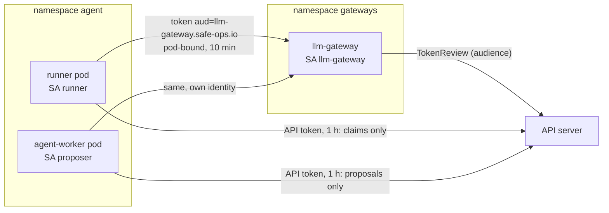

# 03 - Tool access: identity, policy and prompt-injection defence

## Goal
The agent reaches models and tools only through gateways, under its own identity, holding no secrets. A policy engine outside the model decides each action, and prompt-injection attacks fail at a named layer even when the model complies.

Requirements and status: [docs/prd/projects/p3-tool-identity-policy.md](../../docs/prd/projects/p3-tool-access.md).

## Milestones
1. [x] Per-agent workload identity: one service account per agent, audience-bound pod-bound tokens, and the gateway's authentication. `make p3 test-identity`: 42 checks
2. [ ] LLM gateway holding the model key, with token budgets; the agent loop becomes model-driven
3. [ ] MCP servers behind a gateway brokering secrets; pinned descriptors
4. [ ] Semantic action gate (Kyverno, OPA or ValidatingAdmissionPolicy)
5. [ ] Prompt-injection red-team

## How it works



- **One identity per agent** (P3-01, P3-05). The shared `agent/agent` service account is gone. `runner` (P1's agent Job) may claim sandboxes and nothing else; `proposer` (P2's Temporal worker) may propose ChangeRequests and nothing else. The admission guard, the claim policy and the kill switch match the namespace's group, `system:serviceaccounts:agent`, so every identity there is covered, including ones added later, and the guard's allowlist is per identity: a runner can't propose even with widened RBAC, and a new identity (`agent/default` in the tests) can write nothing.
- **Tokens for the gateway.** Each agent pod gets a projected token for audience `llm-gateway.safe-ops.io`, bound to the pod, valid 10 minutes and refreshed by the kubelet, at `/var/run/secrets/safe-ops.io/llm-gateway/token`. The API server refuses it (wrong audience); the gateway refuses the pod's API token for the same reason. A copy taken out of the pod is useless for anything but that gateway, and dies with the pod.
- **API tokens for an hour, not a year.** Agents, the approval controller and the gateway don't automount their service account token; they project one with `expirationSeconds: 3600` at the usual path, with the CA and namespace, so client code is unchanged (finding 2).
- **The gateway's front door** (`gateway/internal/authn`). Every request's bearer token goes to the API server as a TokenReview for the gateway's audience. It is accepted only if it's authenticated for that audience, belongs to a service account, is bound to a pod (tokens minted by hand with `kubectl create token` are refused), and the identity is on the gateway's list. Reviews are cached for 10 s, which bounds how long a revoked identity can still get in. If the API server can't be reached, requests are refused and the failure isn't cached. Each decision is logged with the identity, pod and token ID (`credential-id`).
- **TokenReview, not offline JWT checks.** Verifying signatures against the API server's JWKS would avoid the API call, but a review also checks that the pod and the service account still exist. So deleting the pod, or the kill switch recreating the service accounts, revokes the token at the gateway within the cache TTL rather than when it expires.
- **The gateway's reach.** It may create TokenReviews and nothing else (not `system:auth-delegator`, which adds SubjectAccessReviews). Its namespace denies everything except ingress on 8080 from the agent namespace and egress to the API server. Agent pods may resolve the gateway's name, the only name Cilium's DNS proxy answers for them, and connect to it; other namespaces and sandboxes can't.
- **SPIFFE/SPIRE: not now.** Projected tokens give each agent a cryptographic identity attested by the API server and kubelet, scoped by audience, bound to the pod and revocable, with nothing extra to run. SPIRE would add X.509 SVIDs for mutual TLS (P3-24, a Could), federation across clusters, and workloads outside Kubernetes; none is needed yet. Revisit for mTLS between agents, gateways and tools ([GAP-04](../../docs/known-gaps.md#gap-04-agent-to-gateway-traffic-is-plaintext)).

## Findings
1. **Impersonating a service account adds its groups.** `kubectl --as=system:serviceaccount:agent:x` gets `system:serviceaccounts` and `system:serviceaccounts:agent` automatically, so policies written against the namespace group are exercised by the existing impersonation tests.
2. **Automounted API tokens on this cluster are valid for a year.** The kubelet requests the automount token with a special expiry, and the API server, with `--service-account-extend-token-expiration` on (the default), extends it to a year (it records a `warnafter` of an hour). A copy of an agent's API token would have worked for a year, or until its pod or service account went. Projecting the token explicitly with `expirationSeconds: 3600` isn't extended: our workloads now do that, and the suite checks no pod in our namespaces automounts. Third-party components (Cilium, the sandbox controller, CoreDNS) still do; the cluster-wide fix is the API server flag, for the next cluster rebuild.
3. **One identity's DNS opening is every pod's.** Letting agent pods resolve the gateway meant allowing DNS to kube-dns for the whole namespace, which broke P1's check that agent pods have no cluster DNS. The property that matters is what DNS can carry: the proxy answers only the gateway's name, so the check now resolves the gateway (answered), another cluster name and an exfiltration-shaped name (both refused).
4. **The minimum projected token lifetime is 10 minutes.** `expirationSeconds` below 600 is rejected, so a stolen gateway token is good for at most 10 minutes, and until its pod is deleted, whichever comes first, plus the gateway's 10 s review cache.

## Layout
`gateway/`: the gateway, a Go module built on the host and copied into a distroless image (`make -C gateway test build image`): `internal/authn` (token review, decision, cache; unit-tested), `cmd/gateway` (HTTP server: `/healthz`, `/whoami`). `manifests/`: namespace, the gateway's RBAC, Deployment and Service, network policies (both sides).

## Run
```bash
make p3              # build the gateway, deploy it and its policies
make test-identity   # 42 checks; runs the kill switch once and resumes
```
