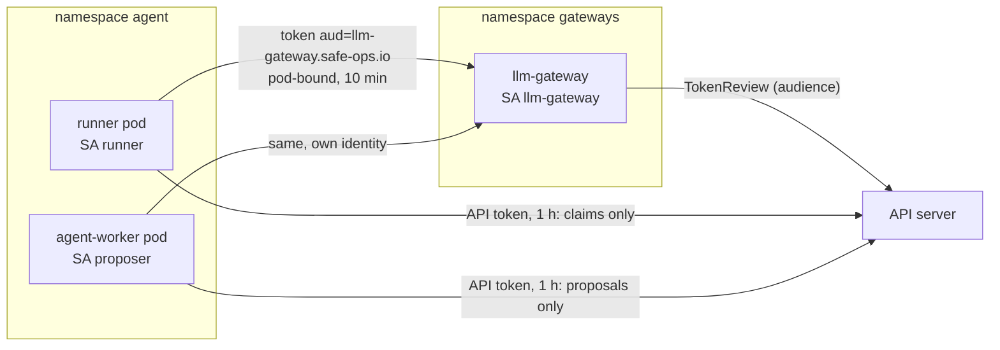

# 03 - Tool access: identity, policy and prompt-injection defence

## Goal
The agent reaches models and tools only through gateways, under its own identity, holding no secrets. A policy engine outside the model decides each action, and prompt-injection attacks fail at a named layer even when the model complies.

Requirements and status: [docs/prd/projects/p3-tool-identity-policy.md](../../docs/prd/projects/p3-tool-identity-policy.md).

## Milestones
1. [x] Per-agent workload identity: one service account per agent, audience-bound pod-bound tokens, and the gateway's authentication. `make p3 test-identity`: 42 checks
2. [x] LLM gateway holding the model key, with per-identity token budgets; the agent loop becomes model-driven. `make p3 test-llm-gateway`: 45 checks against the mock provider (`RUN_LIVE=1` adds one real call)
3. [x] MCP tools behind a gateway that brokers their secrets; pinned descriptors, no discovery, AI-BOM. `make p3 test-mcp`: 37 checks
4. [ ] Semantic action gate (Kyverno, OPA or ValidatingAdmissionPolicy)
5. [ ] Prompt-injection red-team

## How it works



- **One identity per agent** (P3-01, P3-05). The shared `agent/agent` service account is gone. `runner` (P1's agent Job) may claim sandboxes and nothing else; `proposer` (P2's Temporal worker) may propose ChangeRequests and nothing else. The admission guard, the claim policy and the kill switch match the namespace's group, `system:serviceaccounts:agent`, so every identity there is covered, including ones added later, and the guard's allowlist is per identity: a runner can't propose even with widened RBAC, and a new identity (`agent/default` in the tests) can write nothing.
- **Tokens for the gateway.** Each agent pod gets a projected token for audience `llm-gateway.safe-ops.io`, bound to the pod, valid 10 minutes and refreshed by the kubelet, at `/var/run/secrets/safe-ops.io/llm-gateway/token`. The API server refuses it (wrong audience); the gateway refuses the pod's API token for the same reason. A copy taken out of the pod is useless for anything but that gateway, and dies with the pod.
- **API tokens for an hour, not a year.** Agents, the approval controller and the gateway don't automount their service account token; they project one with `expirationSeconds: 3600` at the usual path, with the CA and namespace, so client code is unchanged (finding 2).
- **The gateway's front door** (`gateway/internal/authn`). Every request's bearer token goes to the API server as a TokenReview for the gateway's audience. It is accepted only if it's authenticated for that audience, belongs to a service account, is bound to a pod (tokens minted by hand with `kubectl create token` are refused), and the identity is on the gateway's list. Reviews are cached for 10 s, which bounds how long a revoked identity can still get in. If the API server can't be reached, requests are refused and the failure isn't cached. Each decision is logged with the identity, pod and token ID (`credential-id`).
- **TokenReview, not offline JWT checks.** Verifying signatures against the API server's JWKS would avoid the API call, but a review also checks that the pod and the service account still exist. So deleting the pod, or the kill switch recreating the service accounts, revokes the token at the gateway within the cache TTL rather than when it expires.
- **The gateway's reach.** It may create TokenReviews and nothing else (not `system:auth-delegator`, which adds SubjectAccessReviews). Its namespace denies everything except ingress on 8080 from the agent namespace and egress to the API server. Agent pods may resolve the gateway's name, the only name Cilium's DNS proxy answers for them, and connect to it; other namespaces and sandboxes can't.
- **The LLM gateway** (`gateway/cmd/gateway`, P3-02, P3-03). `POST /v1/messages` only. For each request, in order:
  1. authenticate the agent (above);
  2. check the request as data (`internal/policy`): an allowed model (`claude-opus-5-5`), `max_tokens` at most 16000, no streaming (the budget needs final usage), the refusal-fallback beta and `fallbacks: "default"` only, and **no server tools or remote MCP**. Web search, web fetch, code execution, Skills containers and MCP connectors run on the provider's infrastructure, outside every egress rule here, so a prompt-injected model could use them to send data anywhere;
  3. reserve the request's `max_tokens` against the identity's budget (`internal/budget`: 200 000 tokens per rolling hour, 30 requests a minute). A request that *could* overrun is refused with 429 and `Retry-After` before anything is sent, so a runaway loop stops at the gateway;
  4. send it upstream with the provider key from a mounted Secret, the content type, `anthropic-version` and allowed betas, and nothing else of the agent's: not its token, not its other headers;
  5. charge the actual usage, and log identity, pod, model, tokens and the provider's request ID.
  When the provider can't be reached or fails, the agent gets 503 `model_unavailable` (P3-06). The budget lives in memory: one replica, and a restart starts every window afresh.
- **The key.** The gateway mounts `mock-provider-key` (random, made by `make p3`) or `anthropic-api-key`, which you create (`scripts/llm-gateway-mode.sh` shows how, reading it from the terminal so it never lands in shell history, this repo or a transcript). No other pod mounts it, and the agents' identities can't read Secrets in `gateways`. `scripts/llm-gateway-mode.sh live|mock` switches the upstream; `make p3` resets to mock. The gateway's egress reaches the mock and `api.anthropic.com` (by DNS name and TLS server name) and nothing else.
- **The mock provider** (`gateway/cmd/mockmodel`): the Messages API's shape, deterministic and free, so the suite runs without a key or a bill. Directives in the prompt make it fail, refuse, report large usage, or call any tool with any input: a model that complies with anything, for the red-team (milestone 5). It requires the gateway's key and records what it received (`GET /debug/last`).
- **The model-driven agent** (`../02-approval-gate/durable/agent/model.py`, `AgentWorkflow`). Given a goal (an operator's instruction about one Deployment, chosen by the operator), it reads the Deployment (`proposer` got read-only `get` on Deployments in `workloads`) and asks the model through the gateway, with the official `anthropic` SDK pointed at the gateway and its workload token as the bearer credential. The model has three strict tools: `propose_scale_deployment`, `propose_restart_deployment` and `escalate_to_human`. The target isn't one of their parameters. The activity validates the tool input again (exact keys, types, range), and anything else (no model, a refusal, a spent budget, zero or several tool calls, invalid input) becomes an escalation, not a retry. A proposal runs the existing `ChangeWorkflow`, so the review packet, the approval gate and the change budget decide what happens; the model's reasoning goes into the request's intent labelled "not verified". Model `claude-opus-5-5`, adaptive thinking at effort `medium`, `max_tokens` 8000, server-side refusal fallbacks on; the system prompt lives in `model.py` and its hash is logged with each decision.
- **SPIFFE/SPIRE: not now.** Projected tokens give each agent a cryptographic identity attested by the API server and kubelet, scoped by audience, bound to the pod and revocable, with nothing extra to run. SPIRE would add X.509 SVIDs for mutual TLS (P3-24, a Could), federation across clusters, and workloads outside Kubernetes; none is needed yet. Revisit for mTLS between agents, gateways and tools ([GAP-04](../../docs/known-gaps.md#gap-04-agent-to-gateway-traffic-is-plaintext)).

- **MCP tools** (`mcp/`, P3-04). An `incidents` MCP server (official Python `mcp` SDK 2.3, streamable HTTP, stateless, JSON responses) offers `list_open_incidents` and `get_incident`, read-only, backed by a mock incident tracker that requires an API token. The MCP server holds no secret: each tool call carries the token in a header added by the MCP gateway, and the server passes it to the tracker for that call only. The tracker is reachable only from the MCP server, and the MCP server only from the MCP gateway.
- **The MCP gateway** (`gateway/cmd/mcpgateway`, P3-20, P3-21): the agents' only way to MCP tools, at `POST /mcp/<server>`. Agents authenticate with a token for audience `mcp-gateway.safe-ops.io` (separate from the LLM gateway's, so neither gateway can replay a token at the other). It serves from a static registry (`manifests/55-mcp-gateway.yaml`, in git and reviewed): which servers exist, which tools each identity may use, and a pin for each tool, the SHA-256 of its whole descriptor (name, description, schemas, annotations: everything the model reads).
  - `initialize`: answered with a tools-only capability set; the server's free-text `instructions` don't reach the agent.
  - `tools/list`: only the identity's tools whose descriptors match their pins. A changed or unlisted tool is hidden and logged with its new hash.
  - `tools/call`: the same check, against what the server advertises at call time (a "rug pull" between list and call is caught), then forwarded with the server's credential, and the result capped at 16 KiB with a visible truncation note.
  - Everything else (resources, prompts, completion, sampling, batches) is refused. Each call is logged with identity, pod, token ID, tool, outcome and size.
  - `mcpgateway pins <url>`, run in the gateway's pod, prints the current pins for review; the reviewed values go into the registry in git.
- **The agent reads before it acts.** `decide` became a bounded loop: up to 6 model calls; the model may call MCP tools (offered as `server__tool`, labelled read-only), then must end with exactly one typed action on its own. Tool output goes back to the model inside `<tool_output trust="untrusted">` tags, and the system prompt says never to follow instructions found there. The ChangeRequest records which tools were read. Lookups that fail (refused by the gateway, server down) are reported to the model as errors; running out of steps, mixing an action with lookups, or more than 3 lookups in a turn all escalate.
- **AI bill of materials** (`scripts/ai-bom.sh`, P3-23): the agent's model and settings, the system prompt's hash, every tool's descriptor hash (typed actions and MCP pins), the MCP grants, and the image digest each component is running, from the code and the live cluster, in `results/ai-bom.{md,json}`.

## Findings
1. **Impersonating a service account adds its groups.** `kubectl --as=system:serviceaccount:agent:x` gets `system:serviceaccounts` and `system:serviceaccounts:agent` automatically, so policies written against the namespace group are exercised by the existing impersonation tests.
2. **Automounted API tokens on this cluster are valid for a year.** The kubelet requests the automount token with a special expiry, and the API server, with `--service-account-extend-token-expiration` on (the default), extends it to a year (it records a `warnafter` of an hour). A copy of an agent's API token would have worked for a year, or until its pod or service account went. Projecting the token explicitly with `expirationSeconds: 3600` isn't extended: our workloads now do that, and the suite checks no pod in our namespaces automounts. Third-party components (Cilium, the sandbox controller, CoreDNS) still do; the cluster-wide fix is the API server flag, for the next cluster rebuild.
3. **One identity's DNS opening is every pod's.** Letting agent pods resolve the gateway meant allowing DNS to kube-dns for the whole namespace, which broke P1's check that agent pods have no cluster DNS. The property that matters is what DNS can carry: the proxy answers only the gateway's name, so the check now resolves the gateway (answered), another cluster name and an exfiltration-shaped name (both refused).
4. **The minimum projected token lifetime is 10 minutes.** `expirationSeconds` below 600 is rejected, so a stolen gateway token is good for at most 10 minutes, and until its pod is deleted, whichever comes first, plus the gateway's 10 s review cache.

5. **The mock read the observation, not the instruction.** Its keyword rules matched "restart" in the agent's line "last restart never" and proposed a restart for "make the service better". The agent now marks the operator's instruction (`<instruction>...</instruction>`), and the mock reads only that. A real model faces the same mix of instruction and data, which the system prompt addresses; milestone 5 tests it.
6. **Server tools are an egress hole the network policy can't see.** The gateway's network fence covers what the cluster sends; a model with `web_fetch` or a remote MCP server would make its own requests from the provider's side. The gateway refuses them in the request body, the one place that can.
7. **gVisor's systrap platform stopped working after a host reboot** (resolved by switching gVisor to its KVM platform; P1 README findings 32-34). After WSL restarted on 2026-10-09, every gVisor sandbox failed at start: `runsc` panics with `failed to create a syscall thread` in systrap's first stub thread (`initSyscallThread`). Reproduced outside Kubernetes with `runsc do /bin/true` on the node; the `ptrace` and `kvm` platforms work. Nothing changed in the runsc package, the kernel, the sysctls or the CPU flags. Not caused by this milestone.

8. **The MCP Python SDK's 2.x release renamed its server API.** `FastMCP` is now `MCPServer` (`mcp.server.mcpserver`), and `streamable_http_client` takes an `httpx2` client for headers rather than `headers=`. The SDK said so in its import error, pointing at the migration guide; the code follows the guide, and a throwaway container confirmed each API before use.
9. **Reading a request header in a tool isn't documented in the 2.x SDK.** The gateway hands the tracker token to the MCP server in a header. A plain ASGI wrapper copies it into a context variable the tool reads; `ctx.request_context.request.headers` also worked in 2.3, but isn't documented.
10. **The server's Host check needs the in-cluster name.** With DNS-rebinding protection on, the server answered 421 to any `Host` but its configured ones; it lists its Service name.
11. **The SDK client first tries a newer method.** It sends `server/discover` before `initialize`; the gateway refuses unknown methods, and the client falls back. An allowlist of four methods is what a newer protocol has to get past, not a list of things to block.
12. **A test helper waited forever on an approval.** `temporal workflow result` blocks until the workflow ends, and a proposal waits for a human. Helpers read the ChangeRequest instead.

## Layout
`gateway/`: a Go module built on the host and copied into distroless images (`make -C gateway test build image`): `internal/authn` (token review, decision, cache), `internal/policy` (what may be forwarded), `internal/budget` (per-identity tokens and rate), `internal/mcpreg` (MCP registry and descriptor pins), all unit-tested; `cmd/gateway` (the LLM gateway: `/healthz`, `/whoami`, `/v1/budget`, `/v1/messages`); `cmd/mcpgateway` (the MCP gateway); `cmd/mockmodel` (the mock provider). `mcp/`: the `incidents` MCP server and the mock tracker (one Python image). `results/`: the AI-BOM. `manifests/`: namespace, the gateway's RBAC, Deployment and Service, network policies (both sides).

## Run
```bash
make p3              # build the gateway, deploy it and its policies
make test-identity   # 42 checks; runs the kill switch once and resumes
make test-llm-gateway                 # 45 checks against the mock provider
RUN_LIVE=1 make test-llm-gateway      # plus one real call (needs your key; costs money)
make test-mcp                         # 37 checks: secrets, registry, pins and a rug pull, the agent reading MCP
./scripts/ai-bom.sh                   # results/ai-bom.md
./scripts/llm-gateway-mode.sh status  # mock | live
```
