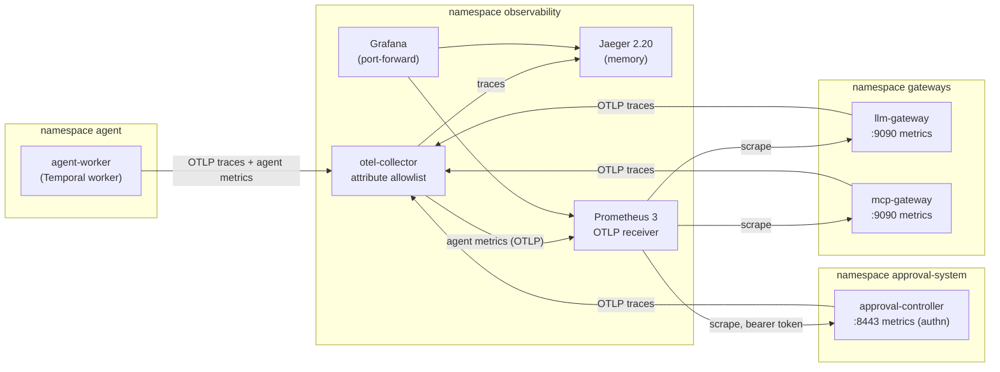

# 04 - Observability and evals

## Goal
What the agent does, what it costs and whether it's still safe are visible by default and checked continuously. Changes to the agent are gated on replayed evaluations.

Requirements and status: [docs/prd/projects/p4-observability-evals.md](../../docs/prd/projects/p4-observability-evals.md).

## Milestones
1. [x] OpenTelemetry GenAI traces; Prometheus and Grafana for tokens, cost and escalation rate. `make p4 test-observability`: 62 checks, 1 known gap ([GAP-06](../../docs/known-gaps.md#gap-06-the-collector-cant-tell-who-sent-a-span))
2. [ ] API audit logging to a store the agent can't write to
3. [ ] Replay eval suite as Jobs or Argo Workflows; blind judge plus deterministic checks
4. [ ] Regression gate on merges (CI)
5. [ ] Oversight and safety metrics; kill-switch test in the suite

## How it works



**One trace per task.** `scripts/agent-task.sh NAME TARGET INSTRUCTION` starts the agent's workflow inside an `agent task` span and prints the trace id. Temporal's tracing interceptor carries the trace through the workflow, its activities and the child workflow that proposes the change. Inside the `decide` activity, the agent records GenAI spans:
- `invoke_agent safe-ops-agent`: the decision, why it escalated if it did, and the prompt's hash;
- `chat claude-opus-5-5` per model call: model, response id, finish reason and token counts;
- `execute_tool <server>__<tool>` per MCP call.

It sends `traceparent` to both gateways, which add their own spans. The LLM gateway's carries the identity, outcome, tokens and estimated cost; the MCP gateway's carries the identity, tool, outcome and, for a refusal, which check refused it. The `propose` activity writes the trace into the ChangeRequest's `approval.safe-ops.io/traceparent` annotation. The controller then adds a `policy gate` span (the Rego result, its policy hash, findings, replicas before and after) and a `settle` span (final phase, who settled it, time to decision) to the same trace. The traceparent is the agent's text, so it decides only which trace a span joins; what the span says comes from the component that wrote it.

**No content in traces (P4-03), enforced twice.** None of the senders record prompts, instructions, model output, tool arguments or tool results. Escalation details, which can quote model output, become a one-word kind (`model_chose`, `invalid_output`, `step_limit`, ...). Independently, the collector deletes every span attribute that isn't on its allowlist, and every span-event attribute except `exception.type`. The agent's inputs are attacker text, so its telemetry is untrusted: a compromised agent sending a span full of content gets it stored without the content (the suite does exactly that).

**Metrics: trusted numbers come from the components that enforce.**

| Metric | From | Labels |
| --- | --- | --- |
| `safeops_llm_tokens_total` | LLM gateway, from the provider's usage | identity, model, type (input, output, cache_write, cache_read) |
| `safeops_llm_cost_usd_total` | LLM gateway, tokens x `PRICES` | identity, model |
| `safeops_llm_requests_total`, `..._duration_seconds` | LLM gateway | identity, model, outcome (ok, policy, rate_limit, token_budget, unavailable, ...) |
| `safeops_mcp_tool_calls_total`, `safeops_mcp_requests_total` | MCP gateway | identity, server, tool, outcome (ok, refused_grant, refused_arguments, refused_pin, ...) |
| `safeops_gate_decisions_total` | approval controller | result (Allow, Escalate, Deny), action |
| `safeops_changerequests`, `safeops_approver_*`, ... | approval controller (oversight, P2-42) | phase, approver, ... |
| `safeops_agent_tasks_total`, `safeops_agent_model_calls_total`, `safeops_agent_tool_calls_total`, `gen_ai_client_*` | the agent, over OTLP (agent-reported) | decision, escalation; outcome; tool |

Labels drawn from the agent's text (model names, server and tool names) are used only when they're known values, else `other`. That bounds cardinality and keeps content out of label values. Every series starts at zero, so the first increment of a series is counted by `increase()`.

**The dashboard** (`dashboards/safe-ops-agent.json`, Grafana's home dashboard) shows, over the selected range:
- tasks, estimated cost, cost per task and tokens per task;
- the agent's escalation rate, the gate's escalation rate, and the share of tasks that needed a human;
- refusals at each gateway, and gate denials;
- the agent's count of model calls minus the gateway's. It should be near zero; a gap means the agent's own numbers can't be trusted;
- time series of tokens, cost, request outcomes and latency, escalations by kind, gate decisions, tool calls and ChangeRequest phases;
- a table of recent traces from Jaeger.

**Who can reach what.**
- The senders reach the collector and nothing else in `observability`.
- Only the collector writes to Jaeger and to Prometheus's OTLP endpoint.
- Prometheus alone reaches the gateways' metrics port.
- The controller's metrics endpoint authenticates and authorizes each scrape. Prometheus's identity may `GET /metrics`, the agent's may not.
- Nothing in `observability` reaches outside the cluster, so telemetry isn't a way out for what the agent writes into it.

Grafana, Jaeger and Prometheus are reached by port-forward (`scripts/observability.sh`). Grafana viewers are anonymous; the admin password is random, in Secret `grafana-admin`.

**Cost is an estimate.** `PRICES` in the LLM gateway's manifest holds the USD per million input and output tokens for each model. The value shipped (`claude-opus-5-5=5:25`) is a placeholder that hasn't been checked against the current price list; set it from the provider's pricing page. Cache writes and reads default to 1.25x and 0.1x the input price.

## Findings
1. **Jaeger 2.21 removed the v1 HTTP query API, which Grafana's Jaeger datasource still uses.** `/api/services` and `/api/traces?service=` answer 404 (jaeger#9260, "remove v1 http endpoints the ui no longer calls"), so Grafana's datasource health check and trace search failed. Pinned 2.20.0; Jaeger's own v3 API (`/api/v3/traces/{id}`) works on both and is what the suite uses.
2. **An OTTL allowlist that silently did nothing.** The collector's transform had the span statement and the span-event statement in one group. OTTL infers one context per group, the narrowest, span event, so `keep_matching_keys(span.attributes, ...)` ran only on spans with events, and most spans kept every attribute. It showed up as a key that wasn't on the allowlist (`jsonrpc.request.id`, from the MCP SDK's spans) appearing in Jaeger. One group per context fixed it, and the suite now sends content straight to the collector to prove it's stripped.
3. **Workflows started from the `temporal` CLI give one trace per activity.** The CLI sends no trace context. Temporal's tracing interceptor then has nothing to parent the workflow's activities to, even with `always_create_workflow_spans`, so observe, decide and the child workflow each started their own trace. Starting the task from a client inside a span (`scripts/agent-task.sh`) puts it all in one. The interceptor rather than Temporal's newer OpenTelemetry plugin because the plugin exports workflow spans only when the workflow ends, and a task can wait an hour for approval.
4. **The MCP Python SDK traces itself.** Version 2.x emits `MCP send <method>` client spans; with the agent's `traceparent` added to the MCP client's requests (an httpx2 request hook), the gateway's spans nest under them.
5. **The collector's k8s distribution has no Prometheus exporter.** Prometheus 3 takes OTLP itself (`--web.enable-otlp-receiver`), so the collector forwards the agent's metrics there with `otlp_http`. Component names in collector 0.161 are `otlp_grpc` and `otlp_http`.
6. **A counter that appears at 1 is invisible to `increase()`.** Prometheus needs a sample before the increment, so a first request created a series that the dashboard counted as zero. Every series the gateways and controller can produce is created at zero at start (allowed identities x models x outcomes; granted tools; results x actions), and the agent adds 0 to each decision and escalation kind.
7. **Two processes, one series.** The task starter set up the same telemetry as the worker. Its zeroed counters had the worker's labels and would have overwritten the worker's values in Prometheus. The starter sends traces only, and each worker's metrics carry its pod as `service.instance.id`.
8. **The agent's metrics can be checked against the gateway's.** The agent says how many model calls it made, and the gateway counts the requests it served for that identity. They matched (4 and 4) in the suite; a dashboard panel shows the difference. The agent's numbers are a hint, the gateway's are the record.
9. **Grafana installs plugins from grafana.com at start.** With no egress it logs errors for each one. `GF_PLUGINS_PREINSTALL_DISABLED=true` stops it.
10. **The controller's metrics need RBAC for its own authentication.** controller-runtime's authenticating filter runs a TokenReview and a SubjectAccessReview per scrape, so the controller needs `create` on both; the suite checks 401 without a token, 403 with the agent's and 200 with Prometheus's.

11. **The collector believes whoever sends it a span (GAP-06).** Network policy decides who may send, but a span's service is what its sender says. From the agent's pod, a span claiming to be `llm-gateway` was stored as the gateway's. Traces stay a debugging aid; the numbers that matter are scraped from the components that enforce.

## Layout
`manifests/`:
- the namespace;
- the collector with its allowlist;
- Jaeger, Prometheus (with its metrics-reader role) and Grafana (with provisioned datasources);
- network policies in `observability` and, for the senders, in `agent`, `gateways` and `approval-system`.

`dashboards/`: Grafana dashboards, published as ConfigMap `grafana-dashboards` by `make p4`.

The instrumentation lives with each component:
- the agent: `../02-approval-gate/durable/agent/telemetry.py`, used from `model.py` and `activities.py`;
- the gateways: `../03-tool-access/gateway/internal/telemetry`, with `internal/pricing` for cost;
- the controller: `../02-approval-gate/internal/telemetry` and `internal/controller/telemetry.go`.

## Run
```bash
make p2 p3 durable               # the senders, instrumented: controller, gateways, agent
make p4                          # collector, Jaeger, Prometheus, Grafana (either order works)
make test-observability          # 62 checks + GAP-06: one trace per task, no content, tokens/cost/escalation, access
scripts/agent-task.sh demo-1 web "Look into incident INC-1001 and fix it."   # prints the trace id
scripts/observability.sh         # Grafana :3000, Jaeger :16686, Prometheus :9090 until Ctrl-C
```
