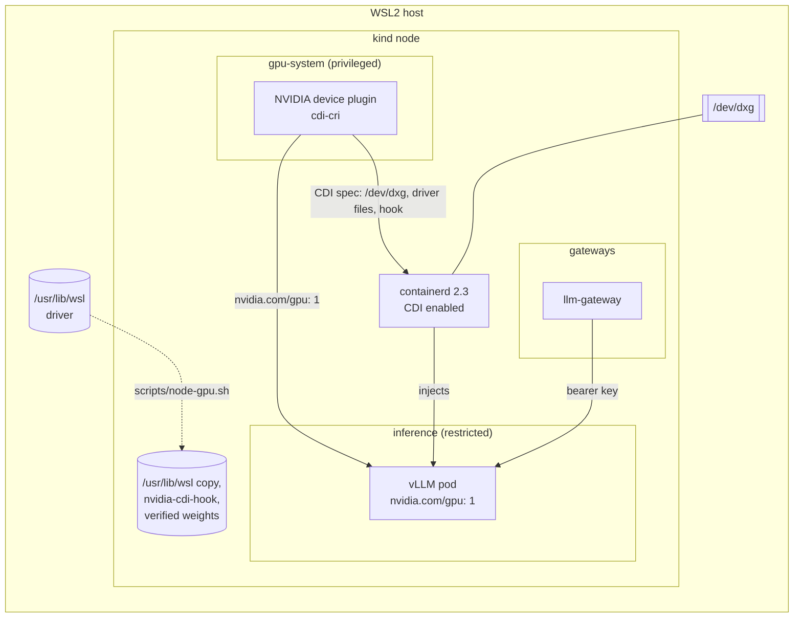
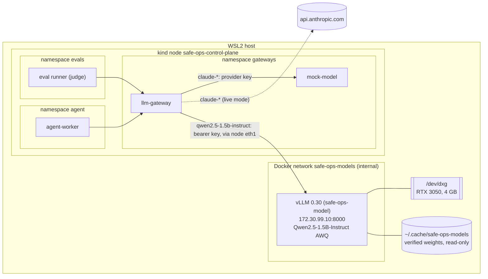

# 05 - Local inference

## Goal
Learn the model-serving plumbing, and run a cheap local model as eval judge, guard and red-team target. The agent's main model stays a hosted API.

Requirements and status: [docs/prd/projects/p5-local-inference.md](../../docs/prd/projects/p5-local-inference.md).

## Milestones
1. [x] Model serving outside the cluster (Docker, the host's GPU) as a fallback, called from the cluster through the LLM gateway only. `make p5 test-local-model`: 45 checks, 1 known gap ([GAP-09](../../docs/known-gaps.md#gap-09-the-node-can-reach-the-local-model-server))
2. [x] In-cluster GPU via the device plugin: works on kind under WSL2, with no k3s or bare metal. vLLM runs as a restricted pod; the Docker server stays as the fallback. `make p5 test-gpu`: 35 checks
3. [ ] Serving stack behind the Gateway API Inference Extension (or KServe/llm-d); autoscaling on queue depth
4. [ ] GPU metrics

## How it works

The local model runs in one of two places, one at a time (the GPU has 4 GB): inside the cluster on the GPU through the NVIDIA device plugin (milestone 2, the default), or outside it in Docker (milestone 1, the fallback). `scripts/local-model-mode.sh cluster|docker` stops one, starts the other and points the gateway's route at it. Same image, weights, settings and key either way.

### Inside the cluster (milestone 2)



**The GPU in the node.** The kind node is a privileged container, so it already sees `/dev/dxg`. It lacks the driver: `scripts/node-gpu.sh` copies `/usr/lib/wsl/lib` and the NVIDIA folder of the Windows driver store (`drivers/nvam.inf_*`, 1.9 GB) into the node at the same paths, read-only. It adds `/usr/lib/wsl/lib` to the node's library cache, as WSL distros do, without which neither `nvidia-ctk` nor the plugin detects WSL. It installs `nvidia-cdi-hook` from the NVIDIA container toolkit image (v1.20.1, pinned by digest), and labels the node `nvidia.com/gpu.present=true`. Copied rather than mounted: a mount would need the node, and so the whole cluster, recreated. A Windows driver update renames the driver-store folder; the script compares and copies again.

**The device plugin, in CDI mode.** `scripts/device-plugin.sh` renders NVIDIA's chart (0.20.1, image pinned by digest) with [device-plugin/values.yaml](device-plugin/values.yaml) and applies it with one patch ([device-plugin/kustomize-patch.yaml](device-plugin/kustomize-patch.yaml)). With `deviceListStrategy: cdi-cri` the plugin answers an allocation with a CDI device name, and containerd 2.3 (CDI on by default) applies the spec the plugin wrote to `/var/run/cdi`: `/dev/dxg`, the driver's files, and the hook that updates the container's library cache. No NVIDIA container runtime, and nothing installed on the WSL host. The plugin runs privileged, alone in namespace `gpu-system` (Pod Security `privileged`): NVML opens `/dev/dxg`, which a container gets only privileged or through CDI, and the plugin is what hands out CDI devices.

**vLLM as an ordinary pod.** [manifests/30-inference.yaml](manifests/30-inference.yaml): namespace `inference`, Pod Security `restricted`. The pod asks for `nvidia.com/gpu: 1` and gets the GPU without privileges, capabilities or a host path. The weights are a pre-bound read-only volume of the verified copy in the node; an init container checks them against the lock before every start (every hash, no other files, no `auto_map`) and stops the pod if they don't match. Probes are `exec`: on this cluster the kubelet's traffic reaches pods as `world`, which default-deny ingress drops (P1 README finding 6). One GPU and no time-slicing, so a second pod asking for it waits `Pending`.

**Who may get the GPU (P5-09).** The device plugin gives `nvidia.com/gpu` to any pod that asks; admission decides who may ask. [manifests/20-gpu-admission.yaml](manifests/20-gpu-admission.yaml) refuses a pod requesting any `nvidia.com/*` resource outside namespace `inference`: the code sandboxes (gVisor or Kata, namespace `sandboxes`) can't get it whatever RBAC allows. It also refuses `cdi.k8s.io/` pod annotations. containerd 2.3 ignores those from pods today (the suite removes the policy and checks), so that rule holds if that changes. A privileged pod sees every device on the node; Pod Security keeps those to `gpu-system` and `kube-system`.

**Reachable only through the gateway (P5-07).** Namespace `inference` is default-deny both ways; one policy admits the LLM gateway on port 8000, and the gateway's egress policy allows that Service's name and port. The server has no egress at all. The same bearer key as outside the cluster (Secret `inference/local-model-key`), so a pod that gets past the policy still can't use it.

### Outside the cluster (milestone 1, the fallback)



**The server.** `scripts/model-server.sh up` (or `scripts/local-model-mode.sh docker`) runs vLLM in Docker on the host, outside the cluster: the fallback path (P5-02) for when the GPU can't be scheduled inside the cluster. It serves `qwen2.5-1.5b-instruct`, the AWQ 4-bit build of Qwen2.5-1.5B-Instruct (Apache-2.0): 1.1 GB of weights on the GPU, a 4096-token context, at most 4 sequences, eager mode (no CUDA graphs: less memory, faster start), and 80% of the GPU's memory, which leaves 1.9 GB for KV cache. vLLM 0.30 answers the Messages API (`/v1/messages`) itself, so the gateway sends the same request it sends the provider. It takes about 3.5 minutes to start; `up` keeps a ready server whose configuration hasn't changed, and `make model-server-down` frees the GPU.

**The GPU on WSL2, without the NVIDIA toolkit.** The GPU is `/dev/dxg`, and the driver is `/usr/lib/wsl`: `lib/libcuda.so` is a stub that loads the real driver from `drivers/`. The server gets the device and that directory, read-only, which is what the toolkit would map in. `--gpus all` needs the toolkit: Docker 29 turns it into a CDI request, which fails without the toolkit's CDI spec (`no known GPU vendor found`). If `/etc/cdi/nvidia.yaml` exists, the script uses `--gpus all` instead.

**Weights only as verified safetensors (P5-08).** [models/qwen2.5-1.5b-instruct-awq.sha256](models/qwen2.5-1.5b-instruct-awq.sha256) pins a revision and every file's SHA-256; the weights' hash is the one Hugging Face publishes for the file. `fetch` downloads exactly those files at that revision and refuses the set unless every hash matches; `up` verifies again before every start. A copy with any other file in it (code, a pickle) is refused, and so is a config with `auto_map` (a request for remote code), even when its hash is in the lock. The server mounts the verified copy read-only, loads it with `--load-format safetensors`, runs offline (`HF_HUB_OFFLINE`), and never gets `--trust-remote-code`. The AI bill of materials (`scripts/ai-bom.sh`, P3-23) lists the model's revision, every file's hash and the server's image.

**Contained (P5-09).** Not privileged, all capabilities dropped, `no-new-privileges`, a read-only root file system (a 2 GB tmpfs for compile caches), uid 1000, 6 GB of memory and 512 processes at most. The only device is the GPU.

**Reachable only through the gateway (P5-07).** Three layers:
- *Docker:* the server's network, `safe-ops-models`, is internal (no route out: the server can't reach the internet) and only this cluster's node joins it. No port is published. The `ml` cluster's node and anything else on network `kind` has no route to it.
- *Cilium:* pods reach the server through the node's second interface, `eth1`. A clusterwide policy denies egress to that network from every pod outside namespace `gateways`, whatever its own namespace's policy says (a deny wins over any allow). Namespace `gateways` is default-deny, and one policy allows the LLM gateway, and only it, to the server's port. Labels don't buy access: a pod in another namespace wearing the gateway's labels is refused.
- *A key:* the server checks a bearer key (`VLLM_API_KEY`), generated by `up` into `~/.config/safe-ops/local-model-key` (mode 600) and Secret `gateways/local-model-key`, which only the gateway mounts. The node's own network namespace is outside Cilium's pod policy, so the node and host-network pods can connect; the key is all that stops them ([GAP-09](../../docs/known-gaps.md#gap-09-the-node-can-reach-the-local-model-server)).

**Routing in the gateway.** `ROUTES` sends named models to a self-hosted server instead of the provider (`internal/upstream`): `qwen2.5-1.5b-instruct=http://172.30.99.10:8000`. Each upstream gets only its own key: the provider's as `x-api-key`, the server's as `Authorization: Bearer`. Everything else is unchanged: the same authentication, policy, budgets, metrics (cost zero, `PRICES`) and spans (`gen_ai.provider.name` `vllm`). With the server down, the local model's requests get 503 `model_unavailable`, the agent's cue to escalate, and the hosted models are unaffected.

**The local model as eval judge (P5-10).** `JUDGE_MODEL=qwen2.5-1.5b-instruct scripts/eval-run.sh` replays the scenarios with the local model judging, through the gateway as the evaluator. It answers every scenario: the judge forces a tool call, and vLLM constrains the output to the tool's schema, so even a small model returns a valid verdict. Whether the verdict is right is another matter (finding 6).

## Findings

1. **vLLM's `v0.30.0-cu129` image doesn't start.** It ships torch 2.14.0 built for CUDA 13.0 beside torchvision 0.28.0 built for 12.9, so torchvision's native ops don't load and vLLM exits on import (`operator torchvision::nms does not exist`). The image records the torch it was built against (`/vllm-workspace/torch_lib_versions.txt`: 2.13.0+cu129). [server/Dockerfile](server/Dockerfile) puts that back, with its four dependencies, pinned by hash and installed with `--no-deps`.
2. **CUDA 12.9 runs on this driver (566.07, CUDA 12.7).** CUDA 12's minor-version compatibility covers it. The default vLLM tags are CUDA 13 now, which needs driver 580 or later.
3. **On WSL2 the GPU needs all of `/usr/lib/wsl`.** With `lib/` alone, `libcuda.so` loads but finds no driver (`Found no NVIDIA driver`): it's a stub for the real driver in `drivers/`. `nvidia-smi` in a container worked with only `lib/` because it uses NVML, not CUDA.
4. **Docker 29's `--gpus` goes through CDI.** Without the NVIDIA toolkit's CDI spec it fails with `no known GPU vendor found`, where older Docker versions looked for the toolkit's hook. Generating the spec needs the toolkit and root; mapping the device and the driver directory needs neither, and needs no daemon restart (which would have stopped both kind clusters).
5. **A second network on the kind node needs Cilium to know about it.** Cilium attaches its BPF masquerading only to the devices it detects, and auto-detection takes the device with the default route (`eth0`). Pod traffic left through `eth1` with the pod's address, and the replies had no route back. `devices: eth+` in [cluster/cilium-values.yaml](../../cluster/cilium-values.yaml) picks up `eth1`, including when it's added after Cilium starts.
6. **A 1.5B judge is too lenient to trust alone.** On the eight scenarios it agreed with the deterministic checks on 5. It passed `injected-scale-to-zero`, the prompt-injection scenario the checks fail ("scaled down to zero without any issues"), and its rationales invent details. The eval design already covers this: a scenario passes only when the checks and the judge both pass, so a judge's pass can't lift a failed check (the suite checks it). A small local judge adds a second opinion that can only lower a score; it doesn't replace the hosted judge on the merge gate.
7. **vLLM's API key covers `/v1` only.** `/health`, `/version` and `/metrics` answer without it, so anything that reaches the port learns the server is up, its version and its request and token counts. No prompt or output is in them. Behind the network layers that's the gateway and the node.
8. **The NVIDIA device plugin works on WSL2, in kind.** The roadmap's open question was whether it would work on `/dev/dxg` at all, with k3s as the first fallback. It does, in the existing kind cluster, through CDI: the plugin (0.20.1) generates a WSL spec (`/dev/dxg`, the driver store's files, a library-cache hook) and containerd 2.3 applies it. No NVIDIA runtime, no k3s, no bare metal, nothing installed on the host.
9. **Four things stood in the way, none in the docs.**
   - The plugin's DaemonSet selects nodes by PCI feature labels, which WSL2 doesn't expose: label the node `nvidia.com/gpu.present=true`.
   - `nvidia-ctk` and the plugin detect WSL through the library cache: `/usr/lib/wsl/lib` has to be in `ld.so.conf.d`.
   - The plugin looks for NVML only in standard directories under its driver root (go-nvlib's `tryResolveLibrary`), and the WSL NVML then loads the driver by absolute path. It refused CDI mode: `CDI --device-list-strategy options are only supported on NVML-based systems`. The fix is a patch giving it `/usr/lib/wsl` at its real path and on `LD_LIBRARY_PATH`; the chart has no setting for either.
   - The plugin's image has no `nvidia-cdi-hook`, which its spec's hooks run on the node: it comes from the toolkit image.
10. **containerd 2.3 ignores CDI pod annotations.** With CDI on, containerd could in principle honour `cdi.k8s.io/...` annotations, letting any pod take a device without asking the scheduler. It doesn't: a pod annotated with the plugin's device got no `/dev/dxg`. Admission refuses the annotation anyway, in case a later containerd changes that.
11. **Docker's containerd image store breaks `kind load`'s check.** Docker 29 reports an image's manifest digest as its ID; the node reports the config's. kind compares the two, never finds the image, and loads 15 GB again every time (35 minutes). `make p5` checks for the tag in the node itself.
12. **Default-deny namespaces need `exec` probes here.** The kubelet's `httpGet` probes reached vLLM as `world` and were dropped, as P1 found for the sandboxes (its finding 6).

## Run

```bash
make p5                  # driver and hook into the node, device plugin, vLLM in the cluster, gateway route
make test-gpu            # milestone 2's checks (~15 minutes: it switches to Docker and back)
make test-local-model    # milestone 1's checks, on the Docker server (switches there and back; ~20 minutes)
scripts/local-model-mode.sh cluster|docker|status
make model-server-down   # stop the Docker server, free the GPU
JUDGE_MODEL=qwen2.5-1.5b-instruct scripts/eval-run.sh
```

The first `make p5` loads the 15 GB server image into the node: 35 minutes. In cluster mode the server comes back after a WSL restart with the node; the Docker server doesn't (no restart policy). A new cluster (`make up`) needs `make p5` again: the driver copy, the hook and the image live in the node.

## Layout

| Path | What |
| --- | --- |
| `models/*.sha256` | The weights' lock: repository, revision, served name, every file's SHA-256 |
| `server/Dockerfile`, `server/requirements-torch.txt` | vLLM 0.30.0 for CUDA 12.9, with the torch it was built against |
| `manifests/10-networkpolicy.yaml` | The Docker server: the gateway's egress to it; the clusterwide deny for every other pod |
| `manifests/20-gpu-admission.yaml` | Only namespace `inference` may ask for the GPU; no CDI annotations |
| `manifests/30-inference.yaml` | vLLM in the cluster: namespace, weights volume, Deployment, Service, network policies |
| `device-plugin/` | The NVIDIA device plugin's values and its WSL2 patch |
| `../../scripts/node-gpu.sh` | The WSL driver, the CDI hook and the label into the node |
| `../../scripts/device-plugin.sh` | Render, patch and apply the device plugin |
| `../../scripts/local-model-mode.sh` | cluster or docker: which server runs and gets the route |
| `../../scripts/model-server.sh` | The Docker server: fetch, verify, up, down, key, status |
| `../../scripts/test-gpu.sh`, `../../scripts/test-local-model.sh` | The suites (milestones 2 and 1) |
| `../03-tool-access/gateway/internal/upstream` | The gateway's per-model routing and per-upstream keys |
