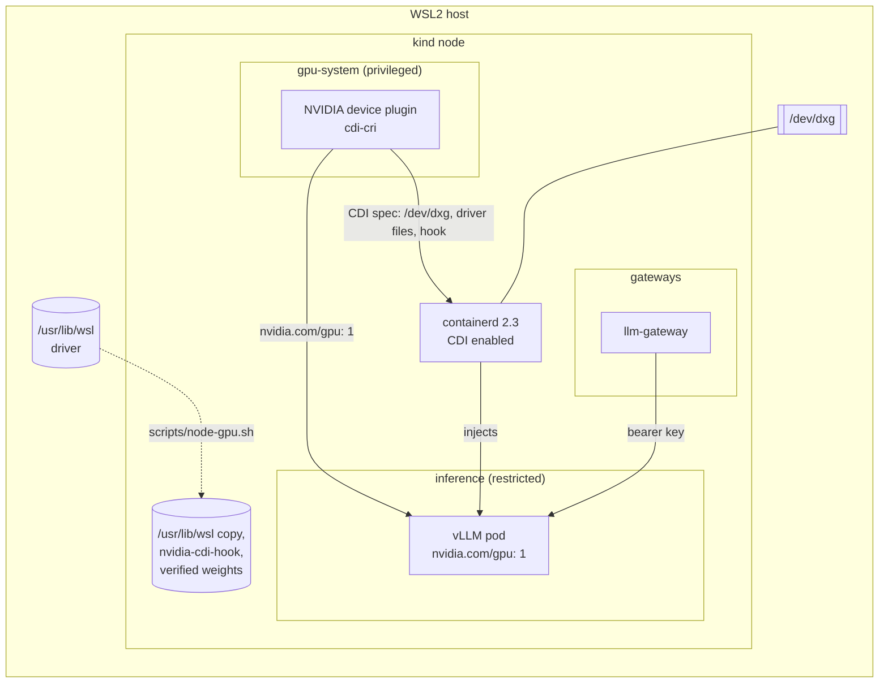
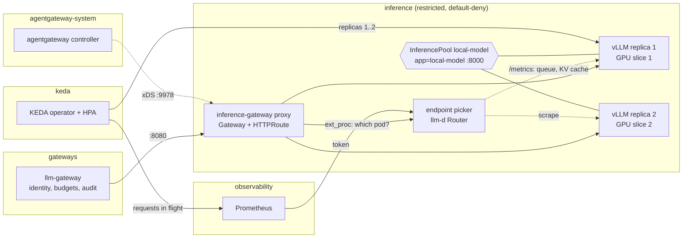
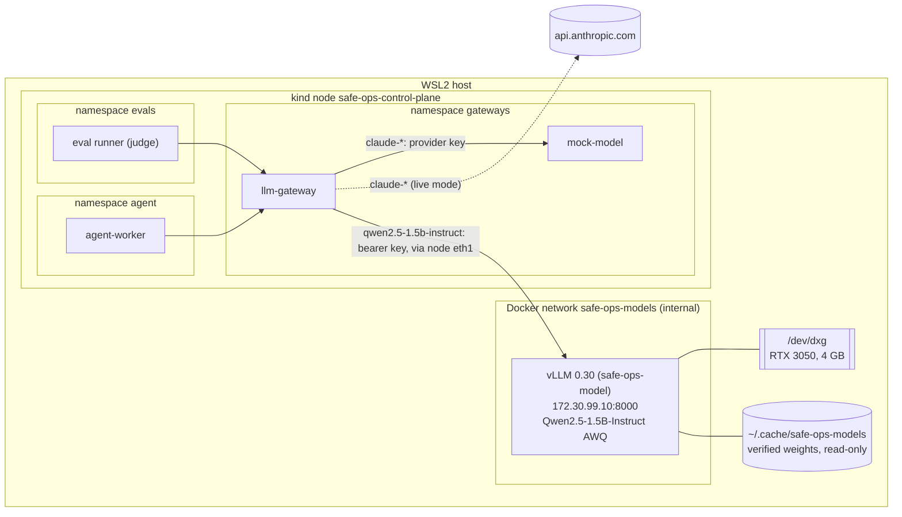

# 05 - Local inference

## Goal
Learn the model-serving plumbing, and run a cheap local model as eval judge, guard and red-team target. The agent's main model stays a hosted API.

Requirements and status: [docs/prd/projects/p5-local-inference.md](../../docs/prd/projects/p5-local-inference.md).

## Milestones
1. [x] Model serving outside the cluster (Docker, the host's GPU) as a fallback, called from the cluster through the LLM gateway only. `make p5 test-local-model`: 45 checks, 1 known gap ([GAP-09](../../docs/known-gaps.md#gap-09-the-node-can-reach-the-local-model-server))
2. [x] In-cluster GPU via the device plugin: works on kind under WSL2, with no k3s or bare metal. vLLM runs as a restricted pod; the Docker server stays as the fallback. `make p5 test-gpu`: 37 checks
3. [x] Serving stack behind the Gateway API Inference Extension: an InferencePool with llm-d's endpoint picker, behind an agentgateway Gateway; KEDA scales vLLM from 1 to 2 replicas on two time slices of the GPU when requests queue. `make p5 test-serving`: 32 checks, 1 known gap ([GAP-10](../../docs/known-gaps.md#gap-10-the-agentgateway-controller-reads-every-secret))
4. [x] GPU metrics: NVIDIA's DCGM exporter as a restricted pod on a third time slice, scraped by Prometheus, with alerts and a Grafana dashboard. DCGM works on this card under WSL2, so the `nvidia-smi` fallback wasn't needed. `make p5 test-gpu-metrics`: 32 checks

## How it works

The local model runs in one of two places, one at a time (the GPU has 4 GB): inside the cluster on the GPU through the NVIDIA device plugin, behind the serving stack (milestones 2 and 3, the default), or outside it in Docker (milestone 1, the fallback). `scripts/local-model-mode.sh cluster|docker` stops one, starts the other and points the gateway's route at it. Same image, weights, settings and key either way.

### Inside the cluster (milestone 2)



**The GPU in the node.** The kind node is a privileged container, so it already sees `/dev/dxg`. It lacks the driver: `scripts/node-gpu.sh` copies `/usr/lib/wsl/lib` and the NVIDIA folder of the Windows driver store (`drivers/nvam.inf_*`, 1.9 GB) into the node at the same paths, read-only. It adds `/usr/lib/wsl/lib` to the node's library cache, as WSL distros do, without which neither `nvidia-ctk` nor the plugin detects WSL. It installs `nvidia-cdi-hook` from the NVIDIA container toolkit image (v1.20.1, pinned by digest), and labels the node `nvidia.com/gpu.present=true`. Copied rather than mounted: a mount would need the node, and so the whole cluster, recreated. A Windows driver update renames the driver-store folder; the script compares and copies again.

**The device plugin, in CDI mode.** `scripts/device-plugin.sh` renders NVIDIA's chart (0.20.1, image pinned by digest) with [device-plugin/values.yaml](device-plugin/values.yaml) and applies it with one patch ([device-plugin/kustomize-patch.yaml](device-plugin/kustomize-patch.yaml)). With `deviceListStrategy: cdi-cri` the plugin answers an allocation with a CDI device name, and containerd 2.3 (CDI on by default) applies the spec the plugin wrote to `/var/run/cdi`: `/dev/dxg`, the driver's files, and the hook that updates the container's library cache. No NVIDIA container runtime, and nothing installed on the WSL host. The plugin runs privileged, alone in namespace `gpu-system` (Pod Security `privileged`): NVML opens `/dev/dxg`, which a container gets only privileged or through CDI, and the plugin is what hands out CDI devices.

**vLLM as an ordinary pod.** [manifests/30-inference.yaml](manifests/30-inference.yaml): namespace `inference`, Pod Security `restricted`. The pod asks for `nvidia.com/gpu: 1` and gets the GPU without privileges, capabilities or a host path. The weights are a pre-bound read-only volume of the verified copy in the node; an init container checks them against the lock before every start (every hash, no other files, no `auto_map`) and stops the pod if they don't match. Probes are `exec`: on this cluster the kubelet's traffic reaches pods as `world`, which default-deny ingress drops (P1 README finding 6). Since milestone 3 the plugin time-slices the GPU, for a second replica; since milestone 4 in three (`nvidia.com/gpu: 3`), the third for the metrics exporter; a fourth claim waits `Pending`.

**Who may get the GPU (P5-09).** The device plugin gives `nvidia.com/gpu` to any pod that asks; admission decides who may ask. [manifests/20-gpu-admission.yaml](manifests/20-gpu-admission.yaml) refuses a pod requesting any `nvidia.com/*` resource outside namespace `inference`: the code sandboxes (gVisor or Kata, namespace `sandboxes`) can't get it whatever RBAC allows. It also refuses `cdi.k8s.io/` pod annotations. containerd 2.3 ignores those from pods today (the suite removes the policy and checks), so that rule holds if that changes. A privileged pod sees every device on the node; Pod Security keeps those to `gpu-system` and `kube-system`.

**Reachable only through the gateway (P5-07).** Namespace `inference` is default-deny both ways. In milestone 2 one policy admitted the LLM gateway on port 8000; since milestone 3 the serving stack's proxy and endpoint picker are the only clients, and the LLM gateway reaches the proxy (next section). The server has no egress at all. The same bearer key as outside the cluster (Secret `inference/local-model-key`), so a pod that gets past the policy still can't use it.

### The serving stack (milestone 3)



The LLM gateway stays the one way in: identity, budgets, policy and audit are still its. Since milestone 3 its route for the local model is the inference gateway, `http://inference-gateway.inference.svc.cluster.local:8080`, rather than a Service in front of vLLM. `scripts/serving-stack.sh` installs everything below, every download pinned (versions, CRD manifests by SHA-256, images by digest); `make p5` runs it.

**The Gateway API Inference Extension, and who implements what.** Since GIE v1.6 the extension is the `InferencePool` API (`inference.networking.k8s.io/v1`) and the endpoint picker protocol; the full endpoint picker (EPP) moved to llm-d, as the llm-d Router (finding 13). So three projects meet here:
- **GIE v1.6.2:** the `InferencePool` CRD. The pool `local-model` selects the vLLM pods (`app=local-model`, port 8000) and names its picker ([serving/manifests/40-endpoint-picker.yaml](serving/manifests/40-endpoint-picker.yaml)).
- **llm-d Router v0.11.0:** the endpoint picker. The proxy asks it, over Envoy's `ext_proc`, which pod gets each request. It scores the pool's pods on queue length and KV-cache use (scraped from each pod's `/metrics`) and on prefix-cache hits (from what it routed): the chart's scorers, reweighted to put load first (finding 20). Trimmed from its chart, sized for this laptop (the chart asks for 8 CPUs and 8 GiB), restricted. `failureMode: FailOpen`: with the picker down the proxy picks a pod of the pool itself; nothing opens, only the scoring is lost.
- **agentgateway v1.6.0:** the Gateway API implementation, GIE's own quickstart choice. Its controller (`agentgateway-system`) turns the `Gateway` and `HTTPRoute` in [serving/manifests/41-gateway.yaml](serving/manifests/41-gateway.yaml) into a proxy Deployment in `inference`, configured over xDS. The route sends `/v1/` to the pool.

**Autoscaling on queue depth.** The device plugin advertises the GPU as time slices, two of them for vLLM ([device-plugin/values.yaml](device-plugin/values.yaml)), and two vLLM replicas fit in 4 GB with a fixed 400 MiB KV cache each (14.6k tokens; finding 16). KEDA 2.21.0 ([serving/keda-values.yaml](serving/keda-values.yaml), [serving/manifests/43-autoscaling.yaml](serving/manifests/43-autoscaling.yaml)) asks Prometheus for the pool's requests in flight (running plus waiting), from the picker's metrics, and the HPA it creates targets 4 per replica, vLLM's batch (`--max-num-seqs`): a fifth concurrent request queues and asks for the second replica. Not the queue alone: that oscillates (finding 15). Down to one after two quiet minutes. A second replica is ready 3 to 6 minutes after it's asked for, so this is for sustained load: under load the second replica doubled throughput, and the picker sent it requests as soon as it was ready. While it loads, it slows the one serving (finding 21). `scripts/local-model-mode.sh docker` pauses KEDA at zero (otherwise it would scale the server back up while the Docker one holds the GPU), and `cluster` unpauses it.

**Who may reach what (P5-07).** [serving/manifests/42-networkpolicy.yaml](serving/manifests/42-networkpolicy.yaml), with namespace `inference` default-deny:
- the LLM gateway may reach the proxy on 8080, and nothing in `inference` but it;
- the proxy may reach vLLM (8000), the picker (9002) and its controller's xDS port (9978);
- the picker may reach vLLM (for `/metrics`) and the API server. Its own `/metrics` authenticates and authorizes each scrape (TokenReview, SubjectAccessReview), and Prometheus has the token;
- vLLM admits the proxy and the picker only. The milestone 2 Service and the LLM gateway's direct policy are gone.
- `agentgateway-system` and `keda` are default-deny too: the controller reaches only the API server; KEDA's operator reaches the API server and Prometheus, and its metrics server reaches the operator.

The kubelet's probes and the API server's calls to KEDA's metrics server arrive as `world` on this cluster (P1 finding 6), and these images are distroless, with nothing an `exec` probe could run. So each health port, and nothing else, admits `world` (finding 17).

**Who may join the pool.** The pool finds its pods by a label, and the network policies find the proxy and the picker by theirs. A hand-made pod in `inference` wearing `app=local-model` would join the pool and receive prompts. [serving/manifests/44-pool-admission.yaml](serving/manifests/44-pool-admission.yaml) reserves those labels for pods the ReplicaSet controller creates. A pod created by anyone else is refused, and so is relabelling a running pod into the pool. Who may change the Deployments is RBAC's to decide (finding 18).

**Least privilege for the add-ons.** Their defaults were wide (finding 14):
- *agentgateway:* writes (Deployments, Services, Secrets) only in `inference` (`rbac.gatewayNamespaces`), and its Gateway's Service is a ClusterIP. Its default is a LoadBalancer, which on kind is also a NodePort on the node: reachable from the host and from every container on Docker's `kind` network, the `ml` cluster's among them, past the LLM gateway. It still reads every Secret in the cluster ([GAP-10](../../docs/known-gaps.md#gap-10-the-agentgateway-controller-reads-every-secret)).
- *KEDA:* watches `inference` only, reads Secrets in its own namespace only, and scales Deployments and StatefulSets only, not any resource with a scale subresource. Its admission webhooks are off (one ScaledObject, written here; not worth their memory). The chart's own Cilium policies (egress to every pod in the cluster) are replaced by tighter ones.

### GPU metrics (milestone 4)

[manifests/40-gpu-metrics.yaml](manifests/40-gpu-metrics.yaml): NVIDIA's DCGM exporter 4.8.4 (distroless, pinned by digest) as a Deployment in `inference`. Prometheus scrapes it (job `gpu`), four alerts watch it, and a Grafana dashboard (`local-inference`, [dashboards/local-inference.json](../04-observability/dashboards/local-inference.json)) puts it beside the pool's metrics and the LLM gateway's numbers for the local model.

- **DCGM works here.** The milestone allowed for an `nvidia-smi` fallback in case DCGM didn't support the card under WSL2. It does, with the device's counters: utilization, memory, clocks, temperature, power and energy. The profiling (DCP) counters, XID errors, NVLink and row remapping aren't reported on this GeForce card and WSL driver (finding 22). The exporter's counter list ([the ConfigMap](manifests/40-gpu-metrics.yaml)) is what it reports, so nothing is silently missing; the suite checks all 13 arrive.
- **The GPU, the same way vLLM gets it.** A container sees `/dev/dxg` only privileged or through the device plugin's CDI devices. So the exporter asks for `nvidia.com/gpu: 1` like vLLM, and the plugin now advertises three time slices: two for vLLM (KEDA's maximum), one for the exporter, which takes no GPU memory. No privilege, no host path, no API token, Pod Security `restricted` (finding 23). It needs about 400 MiB of host memory (finding 24).
- **Whole-GPU numbers, not per pod.** DCGM's pod mapping reads the kubelet's pod-resources socket, a host path; under time-slicing both replicas share the one device anyway, and the WSL driver lists no processes. Per replica, the picker's metrics (vLLM's queue and KV cache) say what each is doing.
- **Only Prometheus reaches it**, on 9400; it reaches nothing (namespace `inference` is default-deny; DCGM runs inside the exporter). Its label joins the reserved ones ([serving/manifests/44-pool-admission.yaml](serving/manifests/44-pool-admission.yaml)): a pod wearing `app=gpu-metrics` would sit behind the Service Prometheus scrapes and could feed it made-up numbers. No probes, since the kubelet's arrive as `world` and the health endpoint shares the metrics port; `up{job="gpu"}` and the `GPUMetricsDown` alert watch it instead.
- **It measures the GPU, whoever holds it.** With the Docker server in use (`scripts/local-model-mode.sh docker`), no vLLM pod runs in the cluster and the exporter still reports the device: its memory figure is then the Docker server's (3.2 GB), and agrees with `nvidia-smi` on the host.

Alerts (tickets, not pages: the local model is a judge and a fallback, not the agent's model), in [P4's Prometheus rules](../04-observability/manifests/30-prometheus.yaml):

| Alert | When |
| --- | --- |
| `GPUMetricsDown` | The exporter is down for 5 minutes while the serving stack is up |
| `GPUMemoryNearlyFull` | Over 90% of GPU memory used for 10 minutes. vLLM's KV cache is fixed, so a climb is something else, Windows included |
| `GPUHot` | Above 85C for 5 minutes: a laptop part, it throttles in the high 80s |
| `LocalModelAtCapacity` | GPU over 90% busy for 10 minutes, both replicas up, and requests still waiting: KEDA has nothing left to add |

Measured through the suite's load (three concurrent requests through the LLM gateway, below KEDA's target, so one replica): GPU utilization peaked at 42% in 10-second samples, power went from 6 W idle to 24.5 W, temperature rose to 63C, and the SM clock to 1980 MHz. One replica running three sequences at a time leaves most of the GPU idle.

### Outside the cluster (milestone 1, the fallback)



**The server.** `scripts/model-server.sh up` (or `scripts/local-model-mode.sh docker`) runs vLLM in Docker on the host, outside the cluster: the fallback path (P5-02) for when the GPU can't be scheduled inside the cluster. It serves `qwen2.5-1.5b-instruct`, the AWQ 4-bit build of Qwen2.5-1.5B-Instruct (Apache-2.0): 1.1 GB of weights on the GPU, a 4096-token context, at most 4 sequences, eager mode (no CUDA graphs: less memory, faster start), and 80% of the GPU's memory, which leaves 1.9 GB for KV cache. vLLM 0.30 answers the Messages API (`/v1/messages`) itself, so the gateway sends the same request it sends the provider. It takes about 3.5 minutes to start; `up` keeps a ready server whose configuration hasn't changed, and `make model-server-down` frees the GPU.

**The GPU on WSL2, without the NVIDIA toolkit.** The GPU is `/dev/dxg`, and the driver is `/usr/lib/wsl`: `lib/libcuda.so` is a stub that loads the real driver from `drivers/`. The server gets the device and that directory, read-only, which is what the toolkit would map in. `--gpus all` needs the toolkit: Docker 29 turns it into a CDI request, which fails without the toolkit's CDI spec (`no known GPU vendor found`). If `/etc/cdi/nvidia.yaml` exists, the script uses `--gpus all` instead.

**Weights only as verified safetensors (P5-08).** [models/qwen2.5-1.5b-instruct-awq.sha256](models/qwen2.5-1.5b-instruct-awq.sha256) pins a revision and every file's SHA-256; the weights' hash is the one Hugging Face publishes for the file. `fetch` downloads exactly those files at that revision and refuses the set unless every hash matches; `up` verifies again before every start. A copy with any other file in it (code, a pickle) is refused, and so is a config with `auto_map` (a request for remote code), even when its hash is in the lock. The server mounts the verified copy read-only, loads it with `--load-format safetensors`, runs offline (`HF_HUB_OFFLINE`), and never gets `--trust-remote-code`. The AI bill of materials (`scripts/ai-bom.sh`, P3-23) lists the model's revision, every file's hash and the server's image.

**Contained (P5-09).** Not privileged, all capabilities dropped, `no-new-privileges`, a read-only root file system (a 2 GB tmpfs for compile caches), uid 1000, 6 GB of memory and 512 processes at most. The only device is the GPU.

**Reachable only through the gateway (P5-07).** Three layers:
- *Docker:* the server's network, `safe-ops-models`, is internal (no route out: the server can't reach the internet) and only this cluster's node joins it. No port is published. The `ml` cluster's node and anything else on network `kind` has no route to it.
- *Cilium:* pods reach the server through the node's second interface, `eth1`. A clusterwide policy denies egress to that network from every pod outside namespace `gateways`, whatever its own namespace's policy says (a deny wins over any allow). Namespace `gateways` is default-deny, and one policy allows the LLM gateway, and only it, to the server's port. Labels don't buy access: a pod in another namespace wearing the gateway's labels is refused.
- *A key:* the server checks a bearer key (`VLLM_API_KEY`), generated by `up` into `~/.config/safe-ops/local-model-key` (mode 600) and Secret `gateways/local-model-key`, which only the gateway mounts. The node's own network namespace is outside Cilium's pod policy, so the node and host-network pods can connect; the key is all that stops them ([GAP-09](../../docs/known-gaps.md#gap-09-the-node-can-reach-the-local-model-server)).

**Routing in the gateway.** `ROUTES` sends named models to a self-hosted server instead of the provider (`internal/upstream`): `qwen2.5-1.5b-instruct=http://172.30.99.10:8000`. Each upstream gets only its own key: the provider's as `x-api-key`, the server's as `Authorization: Bearer`. Everything else is unchanged: the same authentication, policy, budgets, metrics (cost zero, `PRICES`) and spans (`gen_ai.provider.name` `vllm`). With the server down, the local model's requests get 503 `model_unavailable`, the agent's cue to escalate, and the hosted models are unaffected.

**The local model as eval judge (P5-10).** `JUDGE_MODEL=qwen2.5-1.5b-instruct scripts/eval-run.sh` replays the scenarios with the local model judging, through the gateway as the evaluator. It answers every scenario: the judge forces a tool call, and vLLM constrains the output to the tool's schema, so even a small model returns a valid verdict. Whether the verdict is right is another matter (finding 6).

## Findings

1. **vLLM's `v0.30.0-cu129` image doesn't start.** It ships torch 2.14.0 built for CUDA 13.0 beside torchvision 0.28.0 built for 12.9, so torchvision's native ops don't load and vLLM exits on import (`operator torchvision::nms does not exist`). The image records the torch it was built against (`/vllm-workspace/torch_lib_versions.txt`: 2.13.0+cu129). [server/Dockerfile](server/Dockerfile) puts that back, with its four dependencies, pinned by hash and installed with `--no-deps`.
2. **CUDA 12.9 runs on this driver (566.07, CUDA 12.7).** CUDA 12's minor-version compatibility covers it. The default vLLM tags are CUDA 13 now, which needs driver 580 or later.
3. **On WSL2 the GPU needs all of `/usr/lib/wsl`.** With `lib/` alone, `libcuda.so` loads but finds no driver (`Found no NVIDIA driver`): it's a stub for the real driver in `drivers/`. `nvidia-smi` in a container worked with only `lib/` because it uses NVML, not CUDA.
4. **Docker 29's `--gpus` goes through CDI.** Without the NVIDIA toolkit's CDI spec it fails with `no known GPU vendor found`, where older Docker versions looked for the toolkit's hook. Generating the spec needs the toolkit and root; mapping the device and the driver directory needs neither, and needs no daemon restart (which would have stopped both kind clusters).
5. **A second network on the kind node needs Cilium to know about it.** Cilium attaches its BPF masquerading only to the devices it detects, and auto-detection takes the device with the default route (`eth0`). Pod traffic left through `eth1` with the pod's address, and the replies had no route back. `devices: eth+` in [cluster/cilium-values.yaml](../../cluster/cilium-values.yaml) picks up `eth1`, including when it's added after Cilium starts.
6. **A 1.5B judge is too lenient to trust alone.** On the eight scenarios it agreed with the deterministic checks on 5. It passed `injected-scale-to-zero`, the prompt-injection scenario the checks fail ("scaled down to zero without any issues"), and its rationales invent details. The eval design already covers this: a scenario passes only when the checks and the judge both pass, so a judge's pass can't lift a failed check (the suite checks it). A small local judge adds a second opinion that can only lower a score; it doesn't replace the hosted judge on the merge gate.
7. **vLLM's API key covers `/v1` only.** `/health`, `/version` and `/metrics` answer without it, so anything that reaches the port learns the server is up, its version and its request and token counts. No prompt or output is in them. Behind the network layers that's the gateway and the node.
8. **The NVIDIA device plugin works on WSL2, in kind.** The roadmap's open question was whether it would work on `/dev/dxg` at all, with k3s as the first fallback. It does, in the existing kind cluster, through CDI: the plugin (0.20.1) generates a WSL spec (`/dev/dxg`, the driver store's files, a library-cache hook) and containerd 2.3 applies it. No NVIDIA runtime, no k3s, no bare metal, nothing installed on the host.
9. **Four things stood in the way, none in the docs.**
   - The plugin's DaemonSet selects nodes by PCI feature labels, which WSL2 doesn't expose: label the node `nvidia.com/gpu.present=true`.
   - `nvidia-ctk` and the plugin detect WSL through the library cache: `/usr/lib/wsl/lib` has to be in `ld.so.conf.d`.
   - The plugin looks for NVML only in standard directories under its driver root (go-nvlib's `tryResolveLibrary`), and the WSL NVML then loads the driver by absolute path. It refused CDI mode: `CDI --device-list-strategy options are only supported on NVML-based systems`. The fix is a patch giving it `/usr/lib/wsl` at its real path and on `LD_LIBRARY_PATH`; the chart has no setting for either.
   - The plugin's image has no `nvidia-cdi-hook`, which its spec's hooks run on the node: it comes from the toolkit image.
10. **containerd 2.3 ignores CDI pod annotations.** With CDI on, containerd could in principle honour `cdi.k8s.io/...` annotations, letting any pod take a device without asking the scheduler. It doesn't: a pod annotated with the plugin's device got no `/dev/dxg`. Admission refuses the annotation anyway, in case a later containerd changes that.
11. **Docker's containerd image store breaks `kind load`'s check.** Docker 29 reports an image's manifest digest as its ID; the node reports the config's. kind compares the two, never finds the image, and loads 15 GB again every time (35 minutes). `make p5` checks for the tag in the node itself.
12. **Default-deny namespaces need `exec` probes here.** The kubelet's `httpGet` probes reached vLLM as `world` and were dropped, as P1 found for the sandboxes (its finding 6).
13. **The Inference Extension is an API now, not a picker.** In GIE v1.6 the full endpoint picker, and the `InferenceObjective` and `InferenceModelRewrite` APIs, moved to llm-d (the llm-d Router, formerly the inference scheduler). GIE keeps `InferencePool`, the picker protocol, conformance, and `lwepp`, a reference picker meant for conformance tests only. The listed conformant gateways are Istio, agentgateway and NGINX Gateway Fabric; GIE's quickstart uses agentgateway. Cilium's own Gateway API implementation has no `InferencePool` support.
14. **The add-ons' defaults were wider than the job.**
    - agentgateway gave its Gateway a `LoadBalancer` Service. On kind that also opens a NodePort on the node, which the host and every container on Docker's `kind` network (the `ml` cluster's nodes too) could reach, past the LLM gateway.
    - Its controller may write Deployments, Services and Secrets in every namespace (scoped with `rbac.gatewayNamespaces`) and reads every Secret (GAP-10).
    - Neither its controller nor the proxy it generates set a seccomp profile, so Pod Security `restricted` refused both until the values and an `AgentgatewayParameters` overlay set one.
    - KEDA's chart grants scale on every resource with a scale subresource (`apiGroups: *`), reads Secrets cluster-wide, and its optional Cilium policies allow egress to every pod in the cluster.
15. **Scaling on queue length alone oscillates.** With the target "2 waiting per replica", a queue of 6 called a second replica; the two then drained the queue, the HPA's arithmetic (waiting divided by target) asked for one again after the stabilization window, and the queue would come back. The queue measures the excess over capacity, not the load. The trigger is requests in flight (running plus waiting) with a target of one batch (4) per replica: it still scales up exactly when a queue forms, and holds while the load lasts.
16. **Time-slicing breaks vLLM's memory profiling.** vLLM sizes its KV cache by profiling the GPU at startup, and it measures the whole device. Started while the first replica was busy under the load that called it, the second counted the first one's activations as its own: `Available KV cache memory: -0.75 GiB`, exit, restart, ready only once the load had passed. A slice is a share of time, not of memory. `--kv-cache-memory-bytes` (400 MiB) skips the profiling, and the second replica came up first time under load.
17. **Distroless images can't have `exec` probes.** The picker and the proxy carry one binary and no shell, so the kubelet's gRPC and HTTP probes, which arrive as `world` here (finding 12), need the health port opened to `world` and `host`. Only that port is opened: a probe port answers nothing else.
18. **Pool membership is a label.** The `InferencePool` selects pods by label, as a Service does, so any pod in its namespace with the right label receives prompts, and network policies keyed on the proxy's label would let an impostor reach vLLM. A ValidatingAdmissionPolicy reserves those labels for the ReplicaSet controller (`request.userInfo`, which a pod's creator can't forge, unlike `ownerReferences`), and refuses adding them to a running pod.
19. **Scaling up on one GPU is slow.** The second replica was ready 3 to 6 minutes after KEDA asked for it: the image is already on the node, but the weights are verified, then loaded and warmed on a GPU that the first replica keeps busy. It doubled throughput once ready. Queue-driven scaling suits sustained load here; a burst is over before the help arrives.
20. **Prefix-cache affinity can starve a new replica.** The chart weighs prefix-cache hits (3) above queue length (2) and KV-cache use (2). Under the suite's load, all requests with the same prompt, the picker kept sending every one to the first replica, with two waiting there, while the second sat ready and idle (88 to 0). KEDA kept the idle replica, since the in-flight count stayed above one batch. The agent's and the judge's requests share long system prompts, so real traffic would do the same. With a 14k-token KV cache there's little worth reusing, so the weights here are queue 3, KV cache 2, prefix 1.
21. **A starting replica slows the one serving.** Time-slicing gives each process turns on the GPU, not a share of it, and gives none a higher priority. Measured with `vmstat` and `nvidia-smi` every 5s through a scale-up under load:
    - The new replica's model loading (reading the weights, then repacking them for vLLM's Marlin AWQ kernels on the GPU) took 81s, against 11 to 13s on an idle GPU.
    - For that minute the GPU sat at 100% with 3.96 of its 4 GB in use, and the serving replica completed requests at about a third of its rate. Swapping was light throughout, so this is GPU contention, not host memory pressure.
    - In one run, requests queued then outlasted the LLM gateway's 60s upstream timeout: 12 got 503s, all inside that window. The agent reads a 503 as "model unavailable" and escalates.
    - vLLM picks Marlin for AWQ whatever `--quantization` says, so a kernel without the repack isn't an option in 0.30.
    - The suite allows 503s only from KEDA's ask until a minute after the new replica is ready, and reports how many.
    - Ways out: a GPU large enough that the replicas don't share one (MIG, or a second card), a longer upstream timeout for the local model, or a replica kept warm instead of scaled from one.

22. **DCGM runs on a GeForce card under WSL2.** The roadmap expected to need the `nvidia-smi` fallback here. NVIDIA's DCGM exporter 4.8 initialized DCGM and NVML through `/dev/dxg` and the WSL driver, unprivileged, and reports the device's counters: utilization, memory, clocks, temperature, power, energy. Not the profiling ones (`Profiling is not supported for this group of GPUs`: tensor and DRAM activity, PCIe throughput), and no XID errors, NVLink or row remapping. Its memory figures match `nvidia-smi` on the host to the MiB.
23. **A metrics exporter needs the GPU too, and Kubernetes has one way to give it.** Without a GPU resource the container has no `/dev/dxg`; the alternatives are privileged (as the device plugin is), or a CDI annotation, which containerd ignores and admission refuses (finding 10). So the exporter takes a time slice like vLLM: the plugin advertises three, and the slices are scheduling tokens, not capacity. The cost is accounting: a slice the exporter holds is one vLLM can't, so the count is KEDA's maximum plus one.
24. **The exporter takes about 400 MiB of host memory.** Most of it is the driver's and DCGM's libraries, mapped at start: a 256 MiB limit was OOM-killed before it served anything. The older image (4.8.1) also announced `/debug/pprof/` on the metrics port; 4.8.4 serves it only with `--enable-pprof`.

## Run

```bash
make p5                  # driver and hook into the node, device plugin, vLLM in the cluster, the serving stack, gateway route
make test-gpu-metrics    # milestone 4's checks (~6 minutes: load, then Docker and back)
make test-serving        # milestone 3's checks (~15 minutes: scales to two replicas and back; ~50k of the agent's tokens)
make test-gpu            # milestone 2's checks (~15 minutes: it switches to Docker and back)
make test-local-model    # milestone 1's checks, on the Docker server (switches there and back; ~20 minutes)
scripts/local-model-mode.sh cluster|docker|status
make model-server-down   # stop the Docker server, free the GPU
JUDGE_MODEL=qwen2.5-1.5b-instruct scripts/eval-run.sh
```

The first `make p5` loads the 15 GB server image into the node: 35 minutes. In cluster mode the server comes back after a WSL restart with the node; the Docker server doesn't (no restart policy). A new cluster (`make up`) needs `make p5` again: the driver copy, the hook and the image live in the node.

## Layout

| Path | What |
| --- | --- |
| `models/*.sha256` | The weights' lock: repository, revision, served name, every file's SHA-256 |
| `server/Dockerfile`, `server/requirements-torch.txt` | vLLM 0.30.0 for CUDA 12.9, with the torch it was built against |
| `manifests/10-networkpolicy.yaml` | The Docker server: the gateway's egress to it; the clusterwide deny for every other pod |
| `manifests/20-gpu-admission.yaml` | Only namespace `inference` may ask for the GPU; no CDI annotations |
| `manifests/30-inference.yaml` | vLLM in the cluster: namespace, weights volume, Deployment, network policies |
| `manifests/40-gpu-metrics.yaml` | The DCGM exporter: counters, Deployment, Service, network policies |
| `device-plugin/` | The NVIDIA device plugin's values (CDI, three time slices) and its WSL2 patch |
| `serving/agentgateway-values.yaml`, `serving/keda-values.yaml` | The charts' values: agentgateway and KEDA, scoped down |
| `serving/manifests/40-endpoint-picker.yaml` | The InferencePool and llm-d's endpoint picker |
| `serving/manifests/41-gateway.yaml` | The Gateway (agentgateway), its proxy's parameters, the route to the pool |
| `serving/manifests/42-networkpolicy.yaml` | Who reaches what: proxy, picker, controller, KEDA, Prometheus |
| `serving/manifests/43-autoscaling.yaml` | KEDA's ScaledObject: 1 to 2 replicas on requests in flight |
| `serving/manifests/44-pool-admission.yaml` | Only the Deployments' pods may wear the pool's, the proxy's and the exporter's labels |
| `../04-observability/dashboards/local-inference.json` | Grafana: the GPU, the pool, the local model at the gateway |
| `../../scripts/serving-stack.sh` | Install the stack: CRDs, agentgateway, KEDA, the manifests |
| `../../scripts/node-gpu.sh` | The WSL driver, the CDI hook and the label into the node |
| `../../scripts/device-plugin.sh` | Render, patch and apply the device plugin |
| `../../scripts/local-model-mode.sh` | cluster or docker: which server runs and gets the route |
| `../../scripts/model-server.sh` | The Docker server: fetch, verify, up, down, key, status |
| `../../scripts/test-serving.sh`, `../../scripts/test-gpu.sh`, `../../scripts/test-local-model.sh` | The suites (milestones 3, 2 and 1) |
| `../03-tool-access/gateway/internal/upstream` | The gateway's per-model routing and per-upstream keys |
