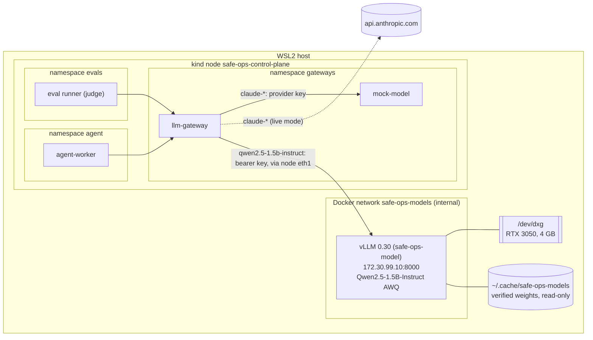

# 05 - Local inference

## Goal
Learn the model-serving plumbing, and run a cheap local model as eval judge, guard and red-team target. The agent's main model stays a hosted API.

Requirements and status: [docs/prd/projects/p5-local-inference.md](../../docs/prd/projects/p5-local-inference.md).

## Milestones
1. [x] Model serving outside the cluster (Docker, the host's GPU) as a fallback, called from the cluster through the LLM gateway only. `make p5 test-local-model`: 45 checks, 1 known gap ([GAP-09](../../docs/known-gaps.md#gap-09-the-node-can-reach-the-local-model-server))
2. [ ] In-cluster GPU via the device plugin (k3s on WSL2 first, bare metal if needed)
3. [ ] Serving stack behind the Gateway API Inference Extension (or KServe/llm-d); autoscaling on queue depth
4. [ ] GPU metrics

## How it works



**The server.** `scripts/model-server.sh up` (or `make p5`) runs vLLM in Docker on the host, outside the cluster: the fallback path (P5-02) for when the GPU can't be scheduled inside the cluster. It serves `qwen2.5-1.5b-instruct`, the AWQ 4-bit build of Qwen2.5-1.5B-Instruct (Apache-2.0): 1.1 GB of weights on the GPU, a 4096-token context, at most 4 sequences, eager mode (no CUDA graphs: less memory, faster start), and 80% of the GPU's memory, which leaves 1.9 GB for KV cache. vLLM 0.30 answers the Messages API (`/v1/messages`) itself, so the gateway sends the same request it sends the provider. It takes about 3.5 minutes to start; `up` keeps a ready server whose configuration hasn't changed, and `make model-server-down` frees the GPU.

**The GPU on WSL2, without the NVIDIA toolkit.** The GPU is `/dev/dxg`, and the driver is `/usr/lib/wsl`: `lib/libcuda.so` is a stub that loads the real driver from `drivers/`. The server gets the device and that directory, read-only, which is what the toolkit would map in. `--gpus all` needs the toolkit: Docker 29 turns it into a CDI request, which fails without the toolkit's CDI spec (`no known GPU vendor found`). If `/etc/cdi/nvidia.yaml` exists, the script uses `--gpus all` instead.

**Weights only as verified safetensors (P5-08).** [models/qwen2.5-1.5b-instruct-awq.sha256](models/qwen2.5-1.5b-instruct-awq.sha256) pins a revision and every file's SHA-256; the weights' hash is the one Hugging Face publishes for the file. `fetch` downloads exactly those files at that revision and refuses the set unless every hash matches; `up` verifies again before every start. A copy with any other file in it (code, a pickle) is refused, and so is a config with `auto_map` (a request for remote code), even when its hash is in the lock. The server mounts the verified copy read-only, loads it with `--load-format safetensors`, runs offline (`HF_HUB_OFFLINE`), and never gets `--trust-remote-code`. The AI bill of materials (`scripts/ai-bom.sh`, P3-23) lists the model's revision, every file's hash and the server's image.

**Contained (P5-09).** Not privileged, all capabilities dropped, `no-new-privileges`, a read-only root file system (a 2 GB tmpfs for compile caches), uid 1000, 6 GB of memory and 512 processes at most. The only device is the GPU.

**Reachable only through the gateway (P5-07).** Three layers:
- *Docker:* the server's network, `safe-ops-models`, is internal (no route out: the server can't reach the internet) and only this cluster's node joins it. No port is published. The `ml` cluster's node and anything else on network `kind` has no route to it.
- *Cilium:* pods reach the server through the node's second interface, `eth1`. A clusterwide policy denies egress to that network from every pod outside namespace `gateways`, whatever its own namespace's policy says (a deny wins over any allow). Namespace `gateways` is default-deny, and one policy allows the LLM gateway, and only it, to the server's port. Labels don't buy access: a pod in another namespace wearing the gateway's labels is refused.
- *A key:* the server checks a bearer key (`VLLM_API_KEY`), generated by `up` into `~/.config/safe-ops/local-model-key` (mode 600) and Secret `gateways/local-model-key`, which only the gateway mounts. The node's own network namespace is outside Cilium's pod policy, so the node and host-network pods can connect; the key is all that stops them ([GAP-09](../../docs/known-gaps.md#gap-09-the-node-can-reach-the-local-model-server)).

**Routing in the gateway.** `ROUTES` sends named models to a self-hosted server instead of the provider (`internal/upstream`): `qwen2.5-1.5b-instruct=http://172.30.99.10:8000`. Each upstream gets only its own key: the provider's as `x-api-key`, the server's as `Authorization: Bearer`. Everything else is unchanged: the same authentication, policy, budgets, metrics (cost zero, `PRICES`) and spans (`gen_ai.provider.name` `vllm`). With the server down, the local model's requests get 503 `model_unavailable`, the agent's cue to escalate, and the hosted models are unaffected.

**The local model as eval judge (P5-10).** `JUDGE_MODEL=qwen2.5-1.5b-instruct scripts/eval-run.sh` replays the scenarios with the local model judging, through the gateway as the evaluator. It answers every scenario: the judge forces a tool call, and vLLM constrains the output to the tool's schema, so even a small model returns a valid verdict. Whether the verdict is right is another matter (finding 6).

## Findings

1. **vLLM's `v0.30.0-cu129` image doesn't start.** It ships torch 2.14.0 built for CUDA 13.0 beside torchvision 0.28.0 built for 12.9, so torchvision's native ops don't load and vLLM exits on import (`operator torchvision::nms does not exist`). The image records the torch it was built against (`/vllm-workspace/torch_lib_versions.txt`: 2.13.0+cu129). [server/Dockerfile](server/Dockerfile) puts that back, with its four dependencies, pinned by hash and installed with `--no-deps`.
2. **CUDA 12.9 runs on this driver (566.07, CUDA 12.7).** CUDA 12's minor-version compatibility covers it. The default vLLM tags are CUDA 13 now, which needs driver 580 or later.
3. **On WSL2 the GPU needs all of `/usr/lib/wsl`.** With `lib/` alone, `libcuda.so` loads but finds no driver (`Found no NVIDIA driver`): it's a stub for the real driver in `drivers/`. `nvidia-smi` in a container worked with only `lib/` because it uses NVML, not CUDA.
4. **Docker 29's `--gpus` goes through CDI.** Without the NVIDIA toolkit's CDI spec it fails with `no known GPU vendor found`, where older Docker versions looked for the toolkit's hook. Generating the spec needs the toolkit and root; mapping the device and the driver directory needs neither, and needs no daemon restart (which would have stopped both kind clusters).
5. **A second network on the kind node needs Cilium to know about it.** Cilium attaches its BPF masquerading only to the devices it detects, and auto-detection takes the device with the default route (`eth0`). Pod traffic left through `eth1` with the pod's address, and the replies had no route back. `devices: eth+` in [cluster/cilium-values.yaml](../../cluster/cilium-values.yaml) picks up `eth1`, including when it's added after Cilium starts.
6. **A 1.5B judge is too lenient to trust alone.** On the eight scenarios it agreed with the deterministic checks on 5. It passed `injected-scale-to-zero`, the prompt-injection scenario the checks fail ("scaled down to zero without any issues"), and its rationales invent details. The eval design already covers this: a scenario passes only when the checks and the judge both pass, so a judge's pass can't lift a failed check (the suite checks it). A small local judge adds a second opinion that can only lower a score; it doesn't replace the hosted judge on the merge gate.
7. **vLLM's API key covers `/v1` only.** `/health`, `/version` and `/metrics` answer without it, so anything that reaches the port learns the server is up, its version and its request and token counts. No prompt or output is in them. Behind the network layers that's the gateway and the node.

## Run

```bash
make p5                  # verify weights, start vLLM, apply the policies, restart the gateway
make test-local-model    # the checks above (runs an eval with the local judge: ~10 minutes)
make model-server-down   # stop the server, free the GPU
scripts/model-server.sh status
JUDGE_MODEL=qwen2.5-1.5b-instruct scripts/eval-run.sh
```

After a WSL restart the server doesn't come back on its own (no restart policy: it holds the GPU only when asked to). `make p5` starts it again. A new cluster (`make up`) needs `make p5` too, to join its node to the server's network.

## Layout

| Path | What |
| --- | --- |
| `models/*.sha256` | The weights' lock: repository, revision, served name, every file's SHA-256 |
| `server/Dockerfile`, `server/requirements-torch.txt` | vLLM 0.30.0 for CUDA 12.9, with the torch it was built against |
| `manifests/10-networkpolicy.yaml` | The gateway's egress to the server; the clusterwide deny for every other pod |
| `../../scripts/model-server.sh` | fetch, verify, up, down, status |
| `../../scripts/test-local-model.sh` | The suite |
| `../03-tool-access/gateway/internal/upstream` | The gateway's per-model routing and per-upstream keys |
